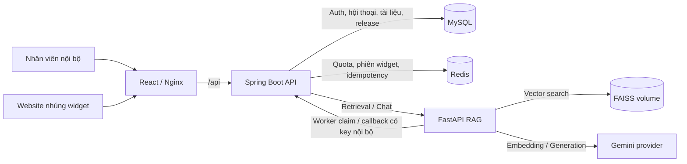
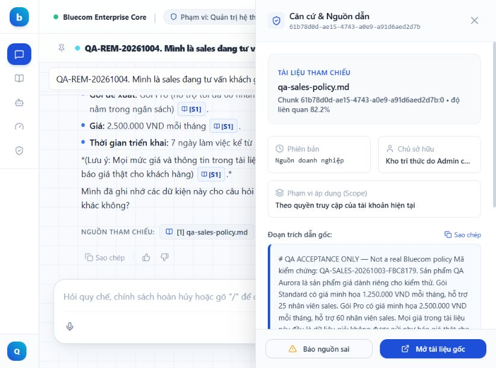
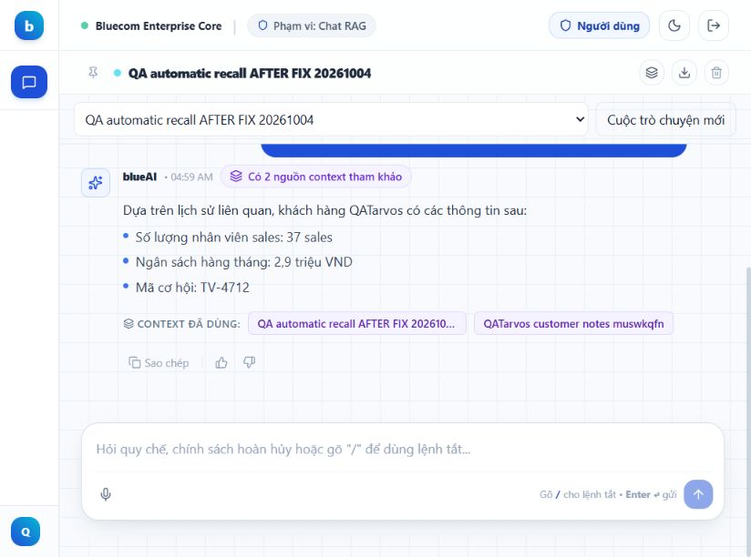

<p align="center">
  
</p>

<h1 align="center">BlueAI Platform</h1>

<p align="center">
  <strong>Tri thức doanh nghiệp · Hội thoại có ngữ cảnh · Kịch bản AI có kiểm soát</strong><br>
  Trợ lý AI nội bộ, bắt đầu từ Sales và hướng đến phục vụ nhiều bộ phận trên cùng nền tảng.
</p>

<p align="center">
  
  
  
  
  
</p>

<p align="center">
  <a href="#4-chạy-local">Chạy local</a> ·
  <a href="#5-tri-thức-và-context">Tri thức &amp; context</a> ·
  <a href="#6-blueai-custom--dialog">BlueAI Custom</a> ·
  <a href="BE/PRODUCTION_DEPLOYMENT.md">Deploy runbook</a> ·
  <a href="docs/manual-tests/TEAM_REVIEW_HANDOFF_2026-10-04.md">Team handoff</a>
</p>

> [!IMPORTANT]
> Sales là phạm vi nghiệp vụ được demo và kiểm thử hiện tại, không phải giới hạn kiến trúc của sản phẩm. Mở rộng sang bộ phận khác cần xác định tài liệu được phép chia sẻ, quyền truy cập và kịch bản sử dụng. **Bản hiện tại chưa có phân quyền kho tri thức theo phòng ban và chưa được duyệt deploy production.**

## Mục lục

- [1. Tổng quan](#1-tổng-quan)
- [2. Phạm vi sử dụng và phân quyền](#2-phạm-vi-sử-dụng-và-phân-quyền)
- [3. Kiến trúc](#3-kiến-trúc)
- [4. Chạy local](#4-chạy-local)
- [5. Tri thức và context](#5-tri-thức-và-context)
- [6. BlueAI Custom / Dialog](#6-blueai-custom--dialog)
- [7. Tích hợp widget](#7-tích-hợp-widget)
- [8. Cấu hình](#8-cấu-hình)
- [9. Bảo mật và production](#9-bảo-mật-và-production)
- [10. Kiểm thử](#10-kiểm-thử)
- [11. Vận hành và xử lý sự cố](#11-vận-hành-và-xử-lý-sự-cố)
- [12. Tài liệu cho team](#12-tài-liệu-cho-team)

## 1. Tổng quan

BlueAI kết hợp ba lớp hỗ trợ công việc:

| Lớp | Giúp người dùng làm gì? | Cách hoạt động |
| --- | --- | --- |
| **Tri thức — RAG** | Tra cứu sản phẩm, quy trình và chính sách có tài liệu tham chiếu | Tìm đoạn tài liệu phù hợp, kiểm tra nguồn rồi cung cấp cho mô hình trả lời |
| **Ngữ cảnh — Context** | Hỏi tiếp mà không phải nhập lại toàn bộ thông tin đã trao đổi | Dùng lịch sử phiên, tóm tắt, ghi nhớ đã xác nhận và phiên liên quan theo chế độ được chọn |
| **Kịch bản — Dialog** | Quy định bot hỏi gì, trả lời gì và xử lý dữ kiện thiếu | Cấu hình intent, entity, node, câu hỏi bổ sung và bước chuyển tiếp trong BlueAI Custom |

Mục tiêu là giảm việc tìm tài liệu thủ công và lặp lại thông tin, đồng thời giúp người dùng kiểm tra **AI dựa vào tài liệu nào và context nào**. Câu trả lời AI vẫn cần được kiểm chứng trước khi dùng làm quyết định hoặc cam kết với khách hàng.

## 2. Phạm vi sử dụng và phân quyền

### Bắt đầu từ Sales, mở rộng bằng nghiệp vụ được phê duyệt

Các bộ phận khác có thể dùng tài khoản nội bộ để truy cập cùng nền tảng. Ví dụ bên dưới là **hướng ứng dụng**, không phải thông báo đã tích hợp các hệ thống tương ứng:

| Bộ phận | Ví dụ ứng dụng | Chuẩn bị trước khi sử dụng |
| --- | --- | --- |
| **Sales — phạm vi demo hiện tại** | Tra cứu sản phẩm, làm rõ nhu cầu, ghi nhớ trao đổi, thu thập yêu cầu báo giá | Tài liệu đã duyệt; dữ liệu demo không thay báo giá thật |
| **CSKH** | Tra cứu FAQ, hướng dẫn đổi trả, chuẩn bị phản hồi | Quy trình được duyệt; không suy diễn trạng thái đơn hàng nếu chưa tích hợp dữ liệu |
| **Kỹ thuật / IT** | Tìm runbook, hướng dẫn xử lý sự cố, giải thích tài liệu | Không upload mật khẩu, token hoặc thông tin hạ tầng nhạy cảm |
| **Vận hành** | Tra cứu SOP, checklist và quy trình phối hợp | Chủ sở hữu tài liệu, phiên bản và phạm vi chia sẻ rõ ràng |
| **Nhân sự / Tài chính** | Tra cứu chính sách chung được phép phổ biến | Chưa dùng cho hồ sơ nhân sự, lương, tài chính mật khi chưa có ACL theo phạm vi dữ liệu |

### Quyền thực tế của phiên bản hiện tại

| Người dùng | Có thể sử dụng | Giới hạn cần biết |
| --- | --- | --- |
| `USER` | **Hỏi BlueAI**, hội thoại/context của mình, nguồn tri thức dùng chung do admin cung cấp | Không quản trị tài khoản, upload kho tri thức hoặc sửa Studio |
| `ADMIN` | Các chức năng của USER; **Tài liệu & Tri thức RAG**, **BlueAI Custom**, **Token Gemini**, **Quản trị Hệ thống** | Thao tác quản lý tài liệu/bot có ownership; không tự có quyền xem mọi hội thoại cá nhân |
| Người dùng widget | Chat với bot đã phát hành qua phiên widget | Đây là kênh public, không phải tài khoản nội bộ có đầy đủ quyền |

> [!WARNING]
> **Dùng chung AI không có nghĩa là được dùng chung mọi dữ liệu.** Tài liệu `READY` do ADMIN cung cấp có thể được dùng làm nguồn tri thức chung; hiện chưa có kho riêng cho Sales/HR/Finance, tenant isolation hoặc ACL theo phòng ban. Hội thoại và memory cá nhân được giới hạn theo owner, không tự chia sẻ sang đồng nghiệp.

Có thể thử nghiệm nội bộ trên cùng ứng dụng với tài liệu được phép dùng chung. Trước khi mở rộng tới dữ liệu mật, cần phân loại dữ liệu và kiểm tra quyền ở backend/retrieval; **ẩn menu, viết system prompt hoặc tạo bot riêng không thay thế phân quyền**.

## 3. Kiến trúc



Luồng chat nội bộ: **xác thực → chọn context đúng quyền → tìm và kiểm tra nguồn → tạo câu trả lời → lưu hội thoại và hiển thị căn cứ**. Worker xử lý tài liệu bất đồng bộ; frontend không gọi trực tiếp provider.

| Thành phần | Công nghệ / trách nhiệm |
| --- | --- |
| Frontend | React 19, TypeScript, Vite, Tailwind CSS 3; giao diện và Nginx proxy |
| Backend | Java 21, Spring Boot 3.5, Spring Security, JPA; auth, context, Studio, orchestration |
| RAG service | Python 3.13, FastAPI, LangChain, FAISS; ingestion, retrieval và gọi Gemini |
| Database | MySQL 8.4; Flyway 11.20.3 quản lý schema |
| Shared state | Redis 7.4; trạng thái ngắn hạn và giới hạn widget, không thay MySQL lưu hội thoại |
| Kiểm chứng / vận hành | GitHub Actions; bộ ops cho migration, backup/restore, ingress, metrics và log |

<details>
<summary><strong>Cấu trúc repository</strong></summary>

```text
BlueAI_Platform/
├── FE/                          # Giao diện, API client, widget, Nginx
├── BE/
│   ├── src/main/java/com/blueai/ # Auth, RAG/context, Studio, system
│   ├── src/main/resources/      # Cấu hình, Flyway, template Dialog
│   ├── ops/                     # Backup/restore, monitoring, operational tests
│   ├── compose.yaml             # Stack local
│   └── compose.production.yaml  # Override production, dùng cùng file local
├── feature-rag-chatbot/
│   └── rag-chatbot/             # FastAPI, ingestion, FAISS, Python tests
├── docs/manual-tests/           # Test plan, báo cáo, fixture, ảnh bằng chứng
└── .github/workflows/verify.yml # CI
```

</details>

## 4. Chạy local

### Chuẩn bị

- Git và quyền truy cập repository nếu repo riêng tư.
- Docker Desktop/Engine đang chạy, Docker Compose v2. Windows dùng backend WSL2.
- Gemini API key hợp lệ và quyền/quota cho các model được cấu hình.
- Cổng local `3000`, `8080`, `8000`, `33069` còn trống; đủ RAM/đĩa cho build và tài liệu. Không dùng cấu hình local làm sizing production.

Không cần cài riêng Java, Maven, Node hoặc Python nếu chạy bằng Docker. Các lệnh dưới đây dùng PowerShell và bắt đầu từ checkout mới.

### Bước 1 — Lấy source và chuẩn bị cấu hình

```powershell
git clone https://github.com/Ductri2006/BlueAI_Platform.git
cd BlueAI_Platform
# Nếu test bản chưa merge, chọn branch team đang review trước khi build.
cd BE
if (!(Test-Path .env)) { Copy-Item .env.example .env }
```

Nếu đã có checkout hoặc `BE/.env`, giữ cấu hình/công việc hiện có; không ghi đè bằng example. Nhánh bàn giao ngày 04/10/2026 là `feature/conversation-context`, xem [team handoff](docs/manual-tests/TEAM_REVIEW_HANDOFF_2026-10-04.md) để pull đúng bản.

### Bước 2 — Sửa `BE/.env`

Thay toàn bộ placeholder, không copy nguyên các giá trị dưới đây để chạy:

```dotenv
GOOGLE_API_KEY=replace-with-your-provider-key
DB_PASSWORD=replace-with-a-strong-local-db-password
MYSQL_ROOT_PASSWORD=replace-with-a-strong-local-root-password
APP_JWT_SECRET=replace-with-base64-of-at-least-32-random-bytes
APP_WORKER_API_KEY=replace-with-a-long-random-worker-key
APP_WIDGET_CLIENT_KEY_SALT=replace-with-a-long-random-client-salt
APP_BOOTSTRAP_ADMIN_EMAIL=admin@blueai.local
APP_BOOTSTRAP_ADMIN_PASSWORD=replace-with-your-admin-password

# Docker-to-Docker: dùng tên service, không dùng localhost/host.docker.internal.
APP_RAG_RETRIEVAL_BASE_URL=http://rag-ai:8000
APP_LLM_BASE_URL=http://rag-ai:8000
```

Hai URL cuối cần sửa vì `.env.example` có ví dụ `host.docker.internal` dành cho cách chạy khác. Giữ các biến model/CORS còn lại theo example nếu chưa có nhu cầu thay đổi.

<details>
<summary><strong>Tạo JWT secret đúng định dạng bằng PowerShell</strong></summary>

```powershell
$jwtBytes = New-Object byte[] 32
$jwtGenerator = [System.Security.Cryptography.RandomNumberGenerator]::Create()
try {
    $jwtGenerator.GetBytes($jwtBytes)
    [Convert]::ToBase64String($jwtBytes)
} finally {
    $jwtGenerator.Dispose()
}
```

Chép kết quả vào `APP_JWT_SECRET` trong `.env`. Đây là secret của bạn: không chụp màn hình, gửi vào chat hoặc đưa vào Git. Worker key và client salt dùng các giá trị ngẫu nhiên riêng, không tái sử dụng JWT secret.

</details>

`GOOGLE_API_KEY` chỉ được Compose chuyển cho Python RAG. `APP_WORKER_API_KEY` bảo vệ thao tác worker Java ↔ Python. `APP_LLM_API_KEY` là cấu hình token của chat client nội bộ, **không phải** Gemini provider key.

### Bước 3 — Build và khởi động

Chạy từ `BE` để Compose đọc đúng `.env`:

```powershell
docker compose up --build -d --wait
docker compose ps
```

Stack local có **5 service**. MySQL, RAG và Redis cần healthy trước khi API chạy; frontend chờ API healthy. Thời gian build đầu phụ thuộc tải dependency và tài nguyên máy.

| Service | Địa chỉ local mặc định | Ghi chú |
| --- | --- | --- |
| `frontend` | [localhost:3000](http://localhost:3000) | Giao diện; Nginx proxy `/api` |
| `auth-api` | [localhost:8080](http://localhost:8080/actuator/health) | Link health API, không phải trang UI |
| `rag-ai` | Chỉ trong mạng Compose (`rag-ai:8000`) | FastAPI; không publish cổng ra host |
| `mysql` | `localhost:33069` | Database `blueai_auth`, user `blueai` |
| `redis` | Chỉ trong mạng Compose | Không publish cổng ra host |

Override cổng trên máy cá nhân hoặc stack QA có thể khác bảng này. Production không được mở các cổng API/RAG/database như local.

### Bước 4 — Kiểm tra và đăng nhập

```powershell
curl.exe http://localhost:8080/actuator/health
docker compose exec -T rag-ai python -c "import urllib.request; print(urllib.request.urlopen('http://127.0.0.1:8000/health').read().decode())"
docker compose exec -T rag-ai python -c "import urllib.request; print(urllib.request.urlopen('http://127.0.0.1:8000/ready').read().decode())"
docker compose exec -T rag-ai python -c "import urllib.request; print(urllib.request.urlopen('http://127.0.0.1:8000/readiness').read().decode())"
```

- API health cần báo `UP`.
- `/ready` là startup gate: thiếu cấu hình key trả `503`.
- `/readiness` kiểm tra worker sau startup; có thể cần chờ lượt poll đầu tiên.
- `geminiConfigured: true` chỉ xác nhận có cấu hình key, **không chứng minh** key/model/quota hoạt động hoặc kho tri thức đã `READY`.

Mở **http://localhost:3000**, đăng nhập bằng email/mật khẩu bootstrap đã đặt. Tài khoản chỉ được tạo khi email chưa tồn tại; thay biến bootstrap không tự đổi mật khẩu tài khoản đã có. Đăng ký công khai bị tắt; ADMIN tạo USER cho đồng đội.

> [!NOTE]
> Pull source không mang theo database, tài khoản, provider key, tài liệu đã upload hoặc FAISS index trên máy người khác. Checkout mới cần cấu hình riêng, build và nạp tài liệu để test đầy đủ.

## 5. Tri thức và context

### Tạo câu trả lời có tài liệu tham chiếu

1. ADMIN mở **Tài liệu & Tri thức RAG**, upload PDF, DOCX, CSV, TXT hoặc MD; giới hạn file mặc định 20 MiB.
2. Chờ worker chuyển tài liệu sang `READY`: đọc nội dung → chia chunk → embedding → lưu FAISS → cập nhật trạng thái về Java.
3. Hỏi câu có thông tin trong tài liệu. Kiểm tra nguồn `[S1]`, đoạn trích và tài liệu gốc, không chỉ đọc câu trả lời.

Backend đối chiếu nguồn với record tài liệu đủ điều kiện trong MySQL. File chưa `READY`, tài liệu đã xóa hoặc dữ liệu mẫu không được phép không phải nguồn hợp lệ. Request đầu có thể chậm do embedding/index; tốc độ phụ thuộc tài liệu và provider.

`Papers/*.csv` là dữ liệu tổng hợp, không phải chính sách doanh nghiệp được duyệt. Compose hiện **cố định tắt** shared demo knowledge; chỉ thêm `APP_RAG_ALLOW_SHARED_DEMO_KNOWLEDGE=true` vào `.env` không bật được nó. Để test citation, ưu tiên upload [fixture QA](docs/manual-tests/fixtures/qa-sales-policy.md), không dùng giá trong fixture cho khách thật.

### Nhớ thông tin giữa các phiên như thế nào?

| Chế độ | Giá trị API | Phạm vi context |
| --- | --- | --- |
| **Chỉ phiên hiện tại** — mặc định | `CURRENT_CONVERSATION` | Lịch sử, tóm tắt và memory phù hợp; không tự lấy các phiên khác |
| **Các phiên đã liên kết** | `LINKED_CONVERSATIONS` | Thêm snapshot của các phiên bạn chủ động liên kết |
| **Tự tìm trong lịch sử** | `RELEVANT_HISTORY` | Ưu tiên phiên liên kết, tìm thêm lịch sử gần đây cùng owner và phù hợp câu hỏi |

Context có budget, không gửi toàn bộ lịch sử vô hạn cho mô hình. Snapshot liên kết không tự cập nhật theo phiên nguồn; dùng refresh khi cần. Memory được chọn theo trạng thái xác nhận, scope và thời hạn; không biến mọi câu nói thành “sự thật vĩnh viễn”.

**Ví dụ test Sales với dữ liệu giả:** ở phiên A ghi “Khách QATarvos có 37 nhân viên sales, ngân sách 2,9 triệu/tháng, mã cơ hội TV-4712”. Tạo phiên B, chọn **Tự tìm trong lịch sử**, hỏi lại thông tin QATarvos. Kiểm tra nội dung và nhãn nguồn context; đối chiếu chế độ **Chỉ phiên hiện tại** để kiểm tra cách ly.

> [!TIP]
> Context trả lời “đã trao đổi gì”; knowledge base trả lời “tài liệu quy định gì”. Hội thoại không tự thành chính sách được duyệt. Relevance hiện dùng heuristic/từ khóa, không bảo đảm mọi cách diễn đạt đều tìm đúng; nếu quan trọng, liên kết phiên rõ ràng và kiểm tra nguồn.

<details>
<summary><strong>Xem ảnh kiểm thử giao diện — dữ liệu QA, không phải khách hàng thật</strong></summary>

**Câu trả lời có nguồn tri thức:**



**Nhớ thông tin giữa các phiên qua lịch sử liên quan:**



Ảnh là bằng chứng ngày 04/10/2026, không phải cam kết mọi câu hỏi đều thành công. Xem [báo cáo tổng hợp](docs/manual-tests/RESULTS_FOLLOWUP_2026-10-04.md) để biết điều kiện test và phần chưa chạy.

</details>

## 6. BlueAI Custom / Dialog

**BlueAI Custom** là nơi ADMIN cấu hình cách trợ lý hành xử; không chỉ là hộp sửa một câu prompt.

- **Intent:** người dùng muốn làm gì — chào hỏi, hỏi giờ, yêu cầu báo giá.
- **Entity:** dữ kiện trong câu — sản phẩm, số lượng, chi nhánh, xác nhận.
- **Dialog:** node/nhánh, điều kiện khớp, dữ kiện cần hỏi thêm, phản hồi và bước tiếp theo.
- **Customization / Core:** vai trò, giọng điệu, cách trình bày và chính sách dùng nguồn/AI theo cấu hình.
- **Context:** mang dữ kiện sang lượt sau; context preview không đồng nghĩa đã sửa hội thoại thật.

Luồng: **tạo bản nháp → sửa cấu hình → lưu → thử bot → phát hành → chọn cách sử dụng**. Lưu dùng `expectedRevision` để tránh ghi đè bản nháp đã đổi ở nơi khác; publish tạo snapshot release.

Mẫu **Demo sales — 6 kịch bản Dialog** gồm chào hỏi, giờ chi nhánh, thu thập báo giá, xác nhận/từ chối, sửa dữ kiện và fallback. Mẫu không tính giá thật, tạo đơn hàng hay kết nối CRM; Core được tắt để thử Dialog độc lập. Xem [hướng dẫn 6 kịch bản](docs/SALES_DIALOG_SIX_SCENARIOS_DEMO_2026-10-03.md).

> [!WARNING]
> **Phát hành bot và áp dụng làm BlueAI chính là hai thao tác khác nhau.** Cấu hình active cho **Hỏi BlueAI** dùng chung ở cấp nền tảng; kích hoạt một bot sẽ bỏ active của bot khác. Chưa có tự chọn cấu hình theo phòng ban. Đừng áp dụng bot QA làm cấu hình chính nếu chưa được team đồng ý.

## 7. Tích hợp widget

Bot đã phát hành cung cấp script tại tab **Tích hợp**; widget phục vụ ở `/widget.js`. Đây là kênh nhúng riêng với chat nội bộ có đăng nhập.

| API | Quyền / mục đích |
| --- | --- |
| `/api/v1/auth/browser/login`, `/refresh`, `/logout` | Browser auth; refresh cookie, access token trong RAM |
| `POST /api/v1/conversations/{id}/ask` | Đã đăng nhập; hội thoại thuộc owner |
| `GET/PUT /api/v1/conversations/{id}/context` | Đọc/đổi chế độ context đúng quyền |
| `POST /api/v1/conversations/{id}/context-links` | Liên kết snapshot phiên của chính mình |
| `/api/v1/studio/bots/**` | ADMIN quản lý bot của mình, preview/publish |
| `POST /api/v1/widget/{publicKey}/sessions` | Public: tạo phiên bot đã phát hành |
| `POST /api/v1/runtime/sessions/{id}/messages` | Widget token; gửi lượt với `requestId` |

Phiên widget mặc định 30 phút, ghim vào release lúc tạo. Token ở bộ nhớ trang; response public không trả trace intent/entity/node/context nội bộ. Gửi lại cùng `requestId` và nội dung có thể nhận response đã hoàn tất mà không gọi AI thêm; đây là idempotency, không phải chia sẻ context cá nhân của nhân viên.

Quota application mặc định qua Redis: **10 phiên/client/phút, 30 tin/client/phút, 12 tin/phiên/phút, 120 tin/phiên tổng cộng**. Lặp cùng nội dung với ID mới có giới hạn replay riêng; vượt quota trả `429` và `Retry-After`. Redis được bật nhưng lỗi: limiter từ chối công việc mới theo fail-closed, không bỏ qua quota.

`publicKey` là định danh nhúng, **không phải secret**. CORS không thay xác thực/quyền dữ liệu. Chỉ phát hành nội dung được phép public; kiểm tra phạm vi KB/Core trước khi nhúng. Không dùng widget public như cổng truy cập tài liệu nội bộ nhạy cảm.

## 8. Cấu hình

Đọc [example local](BE/.env.example), [example production](BE/.env.production.example) và Compose để biết biến được chuyển vào container. Biến chỉ có trong `.env` nhưng không được Compose tham chiếu không tự xuất hiện trong ứng dụng.

| Nhóm | Biến chính | Lưu ý |
| --- | --- | --- |
| Provider | `GOOGLE_API_KEY` | Không commit, không để trong frontend/log |
| Chat model | `GEMINI_CHAT_MODEL`, `APP_LLM_MODEL` | Source ghim `gemini-3.5-flash-lite`; model BE gửi có thể ghi đè mặc định RAG |
| Fallback | `GEMINI_CHAT_FALLBACK_MODELS` | Hiện `gemini-3.6-flash`; không mặc định sửa được key sai/hết quyền |
| Embedding | `GEMINI_EMBEDDING_MODEL` | Hiện `models/gemini-embedding-001`; đổi model cần kế hoạch re-index |
| Auth | `APP_JWT_SECRET`, `APP_BOOTSTRAP_ADMIN_*` | Secret Base64 ≥32 random bytes; credential bootstrap riêng |
| Database / worker | `DB_PASSWORD`, `MYSQL_ROOT_PASSWORD`, `APP_WORKER_API_KEY` | Không dùng credential dev trong production |
| Browser / widget | `APP_CORS_ALLOWED_ORIGINS`, `APP_WIDGET_ALLOWED_ORIGINS` | Hai chính sách khác nhau; production đặt domain cụ thể |
| Quota / proxy | `APP_WIDGET_*` | Giới hạn, client salt, Redis, trusted proxy CIDR |
| Retrieval | `RAG_MIN_RELEVANCE`, `RAG_MAX_CHUNKS_PER_DOCUMENT`, `RAG_CANDIDATE_MULTIPLIER` | Mặc định `0`, `3`, `8`; đo trên KB trước khi chỉnh |

Tên model là **giá trị trong source**, không bảo đảm provider cho phép tài khoản của bạn sử dụng. Xác nhận model/quota trước khi vận hành; model fallback cũng có thể tạo chi phí.

## 9. Bảo mật và production

Source có kiểm tra quyền server/ownership, password hashing, refresh rotation, cookie HttpOnly/SameSite, Origin guard, upload validation, quota/idempotency, security headers và CI. Chúng không chứng minh hệ thống hết mọi rủi ro.

- Browser dùng refresh cookie, access token trong RAM; nâng từ bản localStorage cũ cần đăng nhập lại.
- Production cần HTTPS/cookie Secure; ưu tiên FE/API cùng origin. Nếu `VITE_API_BASE_URL` khác origin, review CORS và CSP `connect-src` trong [security headers](FE/security-headers.conf), không mở wildcard cho tiện.
- Dùng `compose.yaml` **cùng** `compose.production.yaml`, không chạy override một mình. Runbook nêu điều kiện secret, proxy CIDR, mạng và readiness.
- Không publish API/RAG/MySQL ra Internet; giới hạn metrics và quyền Docker socket của log collector.
- `.gitignore` không thu hồi key từng bị lộ: cần revoke/rotate, kiểm tra lịch sử Git/release artifact.
- FAISS dùng pickle khi nạp index; chỉ nhận index do pipeline tin cậy tạo, không tải index không rõ nguồn.
- Không đưa PII/dữ liệu mật vào provider trước khi có phê duyệt về dữ liệu, quyền và điều kiện sử dụng provider.
- Không coi file validator là antivirus hoặc parser thread là process sandbox.

> [!CAUTION]
> **CI xanh không đồng nghĩa production-ready.** Snapshot QA 04/10/2026 còn 5 HIGH ở npm build-chain (giữ Tailwind 3 theo quyết định hiện tại), 45 OS HIGH trên RAG image và các gate staging chưa hoàn tất. Finding cần xử lý hoặc risk acceptance đúng thẩm quyền, không chỉ ẩn cảnh báo.

Điểm vào: [production runbook](BE/PRODUCTION_DEPLOYMENT.md). Cần team review, HTTPS/proxy thật, tải/soak, ngân sách provider, backup mã hóa ngoài máy chủ, restore/RPO/RTO và migration/rollback trước khi duyệt release.

## 10. Kiểm thử

[Workflow Verify](.github/workflows/verify.yml) chạy backend, Flyway/MySQL, migration/concurrency, RAG/audit, frontend/build và Compose/Nginx/ops. Xem [GitHub Actions](https://github.com/Ductri2006/BlueAI_Platform/actions/workflows/verify.yml) theo **đúng SHA** muốn triển khai.

### Snapshot bằng chứng — 04/10/2026

| Phạm vi | Kết quả đã ghi nhận | Cách đọc |
| --- | --- | --- |
| Backend local verify | 372 executed PASS, 30 skipped | Không nhận 30 skip thành PASS |
| Frontend | 123 PASS; build PASS | Kết quả bản đã test, không bảo đảm thay đổi sau đó |
| RAG | 70 PASS | Không thay kiểm thử provider thật |
| Legacy MySQL | 2 executions PASS riêng | Conditional tests; không cộng thành unique tests mới |
| Manual ledger — 90 tiêu chí | 73 PASS / 8 PARTIAL / 1 FAIL / 8 NOT RUN | Tích lũy, chưa duyệt production |
| Bản bàn giao `b9079fd` | CI 6/6 nhóm PASS | [Run theo SHA này](https://github.com/Ductri2006/BlueAI_Platform/actions/runs/37195333024); không mặc định áp dụng cho SHA khác |

Đọc [manual test plan](docs/manual-tests/MANUAL_TEST_PRODUCTION_GATE_2026-10-03.md), [báo cáo follow-up](docs/manual-tests/RESULTS_FOLLOWUP_2026-10-04.md) và [hướng dẫn tự test](docs/manual-tests/SELF_TEST_FOLLOWUP_2026-10-04.md). Script `qa-*` có giả định stack/port/path riêng; đọc guard trước khi chạy, không trỏ nguyên trạng vào production.

## 11. Vận hành và xử lý sự cố

### Lệnh local thường dùng

Chạy từ `BE`:

```powershell
docker compose ps
docker compose logs --tail 100 rag-ai
docker compose logs --tail 100 auth-api
docker compose up -d --build auth-api
docker compose restart rag-ai
docker compose down
```

`down` không xóa named volumes. MySQL, file tài liệu và FAISS có volume riêng. **Không dùng `down -v` như lệnh sửa lỗi thông thường**: có thể xóa tài khoản, hội thoại, tài liệu và index; chỉ dùng khi có chủ đích reset với backup phù hợp.

| Hiện tượng | Kiểm tra / hướng xử lý |
| --- | --- |
| RAG không healthy, API chờ | Kiểm tra key, thư mục chạy Compose, `/ready`; không in `.env` hoặc cấu hình đã resolve ra nơi chia sẻ |
| Có key nhưng AI lỗi | Kiểm tra model, quyền, quota/connectivity; health không gọi provider để xác minh key |
| `RAG_RETRIEVER_NOT_CONFIGURED` / `LLM_NOT_CONFIGURED` | Đối chiếu URL/path/model; Compose dùng `http://rag-ai:8000`, không dùng `localhost` của container Java |
| `RAG_RETRIEVAL_FAILED` / `LLM_REQUEST_FAILED` | Kiểm tra log đã che thông tin nhạy cảm, RAG/provider; response lỗi không phải trả lời thành công |
| Không có citation | Kiểm tra tài liệu `READY`, chunk phù hợp, chưa xóa và câu hỏi có nội dung trong KB; CSV demo không tự thành nguồn doanh nghiệp |
| Phiên mới không nhớ phiên cũ | Mặc định **Chỉ phiên hiện tại**; đổi mode hoặc liên kết phiên cùng owner, kiểm tra nguồn context |
| `/ready` đạt, `/readiness` lỗi | Kiểm tra worker key, URL Java và poll thành công gần nhất; chờ startup nếu vừa bật stack |
| Widget trả `429` / `503` | Tôn trọng `Retry-After`; kiểm tra quota/Redis, không tắt limiter để né lỗi |
| Đổi embedding model, nguồn cũ mất | Index không tương thích: backup, lên kế hoạch re-ingest/re-upload và kiểm tra citation. Không xóa MySQL để sửa index |
| Đổi bootstrap password không tác dụng | Bootstrap chỉ tạo khi chưa có email; dùng luồng quản trị phù hợp, không reset DB |
| Cổng bị chiếm | Kiểm tra tiến trình/override local; không dừng nhầm ứng dụng khác hoặc mở thêm cổng production |

## 12. Tài liệu cho team

| Bạn cần gì? | Đọc ở đâu? |
| --- | --- |
| Backend, auth và API | [BE/README.md](BE/README.md) |
| Hợp đồng Java ↔ RAG/worker | [RAG_WORKER_CONTRACT.md](BE/RAG_WORKER_CONTRACT.md) |
| Python service | [RAG README](feature-rag-chatbot/rag-chatbot/README.md) |
| Cấu hình Dialog | [6 kịch bản Sales](docs/SALES_DIALOG_SIX_SCENARIOS_DEMO_2026-10-03.md) |
| Context + knowledge base | [QA context/KB](docs/QA_CONTEXT_KB_2026-09-23.md), [follow-up](docs/manual-tests/RESULTS_FOLLOWUP_2026-10-04.md) |
| Pull và chuẩn bị môi trường | [Team handoff](docs/manual-tests/TEAM_REVIEW_HANDOFF_2026-10-04.md) |
| 5 nhóm bản vá đã push | [Push notes](docs/manual-tests/PUSH_NOTES_2026-10-04.md) |
| Kiểm thử trước release | [Manual plan](docs/manual-tests/MANUAL_TEST_PRODUCTION_GATE_2026-10-03.md), [self-test](docs/manual-tests/SELF_TEST_FOLLOWUP_2026-10-04.md) |
| Deploy, monitoring, backup/restore | [Production runbook](BE/PRODUCTION_DEPLOYMENT.md) |

Khi mở rộng sang bộ phận mới, thống nhất **nghiệp vụ → chủ sở hữu tài liệu → quyền chia sẻ → cấu hình AI → bộ câu hỏi kiểm thử → người duyệt**. CRM/ERP, SSO hay phân quyền phòng ban là phạm vi triển khai riêng; README này không khẳng định các tích hợp đó đã có.


