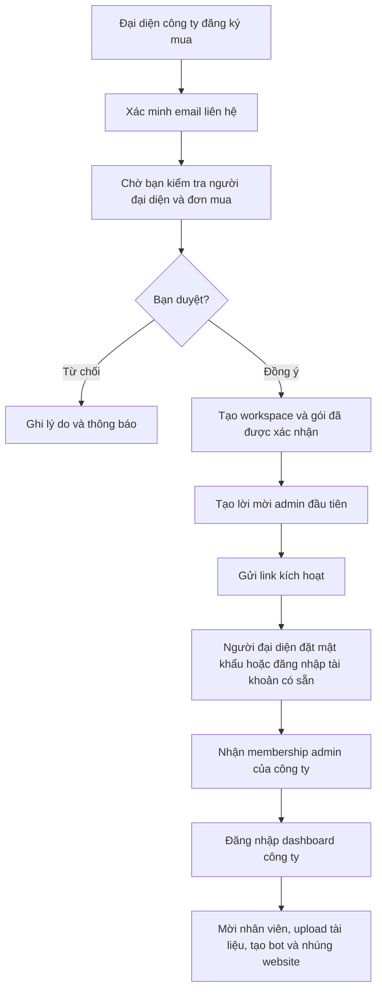

# Thiết kế cấp admin cho khách hàng doanh nghiệp

Ngày: 2026-10-08. Trạng thái: **Đề xuất để chốt, chưa triển khai vào code**.

## 1. Phương án đề xuất

Mỗi công ty mua dịch vụ có một workspace riêng, được nhận diện bằng `tenant_id`.
Bạn giữ quyền **admin nền tảng** để duyệt khách hàng, quản lý gói và khóa/mở công ty.
Người đại diện khách hàng nhận quyền **admin công ty**, chỉ quản lý workspace của mình.

Ở giai đoạn đầu, bạn xác nhận đơn mua rồi bấm duyệt. Hệ thống tạo workspace và
gửi link kích hoạt cho người đại diện; họ tự đặt mật khẩu. Không gửi mật khẩu mặc
định và không cấp quyền quản trị chỉ vì một người đã điền form hoặc dùng email
có tên miền của công ty. Việc kiểm tra email chứng minh quyền kiểm soát hộp thư;
bạn vẫn cần xác nhận người đại diện và đơn mua.

Ví dụ: Công ty A và Công ty B mua cùng gói. Admin A tạo nhân viên, tài liệu và
chatbot cho A; admin B làm tương tự cho B. Dù cùng đăng nhập vào một website,
A không xem được tài liệu, người dùng, lịch sử, API key hoặc quota của B.

## 2. Những gì code hiện tại đã có và còn thiếu

Các nhận xét sau dựa trên source hiện tại, không phải tính năng đã được thiết kế mới:

- `UserRole` có `ADMIN` và `USER`. `User` chưa có quan hệ công ty/membership.
- `AdminAccountBootstrap` tạo admin đầu tiên từ cấu hình môi trường.
- `AdminUserService` tạo người dùng theo role trong request; truy vấn danh sách
  người dùng hiện chưa giới hạn theo công ty.
- `SecurityConfig` bảo vệ nhiều nhóm endpoint bằng `hasRole("ADMIN")`.
  Quyền này chưa phân biệt admin nền tảng và admin khách hàng.
- Endpoint đăng ký tài khoản công khai mặc định bị tắt. Form đăng ký mua mới
  phải là một luồng riêng, không bật lại endpoint test-only để cấp admin.
- Studio/widget đã có kiểm tra owner và allowlist tài liệu. Tuy nhiên owner
  của tài khoản không thay thế cho ranh giới công ty khi có nhiều admin.
- RAG chat có nhánh cho phép nguồn của người sở hữu mang role `ADMIN`;
  Python chỉ lọc owner riêng cho `USER_DOCUMENT`, còn nguồn doanh nghiệp
  chưa được giới hạn bằng tenant. Đây là chỗ phải đổi trước khi phục vụ nhiều công ty.
- Cơ chế một phiên đăng nhập mỗi tài khoản đã có và cần được giữ lại.

Các điểm đối chiếu trong repo:

- [UserRole](<C:/Users/QUANGMINH/Documents/ChatGPT/New project/backend/BE/src/main/java/com/blueai/auth/model/UserRole.java:3>)
- [SecurityConfig](<C:/Users/QUANGMINH/Documents/ChatGPT/New project/backend/BE/src/main/java/com/blueai/auth/config/SecurityConfig.java:74>)
- [AdminUserService](<C:/Users/QUANGMINH/Documents/ChatGPT/New project/backend/BE/src/main/java/com/blueai/auth/service/AdminUserService.java:89>)
- [RegistrationController](<C:/Users/QUANGMINH/Documents/ChatGPT/New project/backend/BE/src/main/java/com/blueai/auth/controller/RegistrationController.java:14>)
- [RagChatService](<C:/Users/QUANGMINH/Documents/ChatGPT/New project/backend/BE/src/main/java/com/blueai/rag/chat/service/RagChatService.java:352>)
- [Python retrieval](<C:/Users/QUANGMINH/Documents/ChatGPT/New project/backend/feature-rag-chatbot/rag-chatbot/app/services/retrieval.py:101>)

## 3. Phân quyền

| Thao tác | Admin nền tảng | Admin công ty | Nhân viên công ty |
|---|---|---|---|
| Duyệt đăng ký mua, tạo công ty | Có | Không | Không |
| Xác nhận gói mua, gia hạn, khóa công ty | Có | Gửi yêu cầu, xem gói của mình | Không |
| Quản lý thành viên | Không mặc nhiên truy cập tài khoản khách hàng | Trong công ty mình | Không |
| Thêm admin công ty | Cấp admin đầu tiên hoặc khôi phục theo quy trình xác minh | Mời admin cùng công ty, theo hạn mức | Không |
| Upload tài liệu, cấu hình RAG/Dialog, publish bot | Không mặc nhiên đọc nội dung khách hàng | Trong công ty mình | Theo quyền sử dụng được cấp |
| Xem lịch sử chat cá nhân | Không mặc nhiên truy cập | Không tự động đọc mọi chat cá nhân | Chat của mình |
| Quản lý integration API key | Không xem secret của khách hàng | Trong công ty mình | Không |
| Xem thống kê | Số liệu vận hành/tổng hợp và doanh thu | Số liệu công ty mình | Theo quyền được cấp |
| Thay cấu hình provider toàn nền tảng, thao tác vận hành | Có | Không | Không |

Admin nền tảng không tự động có quyền đọc dữ liệu RAG/chat của mọi khách hàng.
Nếu sau này cần hỗ trợ kỹ thuật bằng truy cập dữ liệu, thiết kế thêm quyền hỗ
trợ có thời hạn, phạm vi cụ thể và audit; không đưa quyền này vào MVP mặc định.

Một công ty có một admin đầu tiên, có thể có thêm admin sau đó. Không được xóa,
khóa hoặc hạ quyền admin hoạt động cuối cùng nếu chưa có người thay thế. Admin
công ty không được tự nâng mình thành admin nền tảng.

## 4. Luồng từ đăng ký mua đến nhận admin

### Bước 1 — Đăng ký mua

Form gồm: tên công ty, tên người đại diện, email liên hệ, số điện thoại liên hệ
và gói muốn mua. Thông tin xuất hóa đơn bổ sung khi cần, không bắt buộc thu thập
toàn bộ ngay trong form đầu tiên. Tên công ty hoặc domain không được dùng làm
khóa duy nhất để tự ghép người đăng ký vào một công ty có sẵn.

Kết quả chỉ là **yêu cầu đăng ký**, chưa có tài khoản admin hay quyền vào workspace.
Form không nhận `role`, `tenant_id`, `paymentStatus` hoặc hạn mức do khách tự đặt.
Response công khai không tiết lộ email đã thuộc tài khoản nào. Chặn spam bằng
rate limit và xác minh email; gửi lại đơn không tự tạo nhiều workspace.

### Bước 2 — Xác minh và duyệt

Màn hình admin nền tảng có danh sách yêu cầu: công ty, liên hệ, trạng thái email,
gói yêu cầu và trạng thái xác nhận đơn mua. Bạn chọn gói, ngày hiệu lực, ngày hết
hạn, hạn mức và ghi tham chiếu xác nhận đơn mua rồi bấm **Duyệt và gửi lời mời**.

Chỉ duyệt sau khi xác nhận đơn mua, hoặc bạn chủ động cấp trial. Người đăng ký
không tự xác nhận thanh toán. Duyệt hai lần hoặc retry sau lỗi mạng phải trả lại
cùng company/invitation, không tạo thêm công ty và không gửi hai admin độc lập.

### Bước 3 — Provision workspace

Trong cùng transaction: khóa yêu cầu đăng ký, tạo company, subscription, lời mời
admin đầu tiên và bản ghi outbox gửi email. Company bắt đầu ở `PENDING_ACTIVATION`.
Chỉ dùng một company cho mỗi yêu cầu đã duyệt, có unique constraint ở DB.

Không cần tạo một `app_users` hoạt động có mật khẩu tạm ở bước này. Tạo/ghép
identity khi người được mời nhận lời. Role và tenant của lời mời do backend chốt.

### Bước 4 — Kích hoạt

Link mời có hiệu lực đề xuất 24 giờ, dùng một lần; server lưu hash token.
Người chưa có tài khoản đặt mật khẩu và được tạo identity. Người đã có tài khoản
phải đăng nhập đúng email được mời để nhận membership, không bị ghi đè mật khẩu.
Không dùng link mời làm cơ chế takeover tài khoản đã tồn tại.

POST nhận lời phải khóa lời mời, kiểm tra còn hạn/chưa dùng/chưa thu hồi và công ty
còn được phép kích hoạt. Tạo membership rồi đánh dấu lời mời đã nhận trong cùng
transaction. Nếu là admin đầu tiên, company chuyển sang `ACTIVE` khi gói còn
hiệu lực. Sau đó người dùng đăng nhập bình thường; không nhúng access token vào URL.

Chưa nhận lời hoặc link hết hạn: gửi lại lời mời với token mới, thu hồi link cũ,
giữ nguyên workspace và thời hạn gói theo thỏa thuận. Lỗi gửi email không rollback
workspace đã tạo: outbox retry, UI hiển thị trạng thái và cho gửi lại. SMTP/provider
email vẫn cần cấu hình khi triển khai. Payload có token để gửi mail phải được bảo
vệ khi lưu tạm, không xuất hiện trong log hoặc trang danh sách.

## 5. Cách tổ chức dữ liệu đề xuất

Tách **identity đăng nhập** khỏi **vai trò trong công ty** để một email không bị
tạo lại mật khẩu khi tham gia công ty khác trong tương lai.

| Dữ liệu | Các trường/quan hệ chính |
|---|---|
| `company_registrations` | id, company_name, contact_name/email, email_verified_at, requested_plan, status, reviewer_id, decision_at, company_id |
| `companies` | id, name, status, auth_version, approved_registration_id, created_at |
| `company_subscriptions` | company_id, plan_code, status, effective_at, expires_at, seat/bot/storage/AI limits, confirmed_by, confirmation_reference |
| `app_users` | Identity hiện có; thêm platform_role (`NONE` hoặc `SUPER_ADMIN`) |
| `company_memberships` | company_id, user_id, role (`COMPANY_ADMIN` hoặc `MEMBER`), status, auth_version; unique(company_id,user_id) |
| `company_invitations` | company_id, email, role, purpose, token_hash, expires_at, accepted_at, revoked_at, accepted_user_id |
| `notification_outbox` | invitation/event reference, trạng thái gửi, số lần thử, lần thử tiếp; bảo vệ payload nhạy cảm |
| Tài nguyên khách hàng | tenant_id trên bot/release/widget session, document, conversation/memory, integration client/task, audit và usage |

Role công ty nằm trong membership; role nền tảng nằm trên identity. Field `role`
hiện tại chỉ phục vụ chuyển đổi trong migration, không tiếp tục là nguồn cấp
quyền toàn cục cho mọi request khách hàng. MVP có thể chỉ bật một công ty cho mỗi
tài khoản; mô hình membership vẫn hỗ trợ mở rộng mà không phá tính duy nhất email.

Không lưu số tiền/gói/hạn mức tùy ý do public form gửi. Giá và quyền sử dụng đến
từ cấu hình gói server và quyết định xác nhận đơn mua. Chưa tích hợp cổng thanh toán
ở phương án này; sau này webhook đã xác thực có thể thay thao tác xác nhận thủ công.

## 6. Tách dữ liệu công ty xuyên suốt Java và Python

1. **Request đã đăng nhập:** tenant context lấy từ token được backend cấp và
   membership kiểm tra ở server. Mọi truy vấn tài nguyên phải có tenant predicate;
   giữ thêm owner predicate cho dữ liệu riêng tư của từng người.
2. **JWT/session:** giữ `sessionId` và `authVersion` hiện có; bổ sung tenant,
   membership role/version và tenant auth version cho session công ty. Kiểm tra
   membership và tenant còn hoạt động; không chỉ tin role lưu trong JWT cũ.
   Token quản trị nền tảng không mặc nhiên thay thế token công ty.
3. **RAG:** chia index FAISS theo tenant, ví dụ `RAG_INDEX_DIR/<tenantUUID>/`.
   Worker nhận tenant từ bản ghi document của Java; không lấy tenant từ file upload.
   Chunk metadata có tenant, owner và visibility (`PRIVATE` hoặc `COMPANY`).
   Thiếu tenant hoặc tenant không khớp thì từ chối/không truy xuất.
4. **Nguồn doanh nghiệp:** chỉ chia sẻ cho membership cùng công ty. Bỏ cơ chế
   “tài liệu của bất kỳ ADMIN nào cũng là nguồn dùng chung”. Demo dùng chung nếu
   cần phải được tách riêng và bật rõ ràng; không trộn dữ liệu thật giữa công ty.
5. **Widget nhúng:** public key của bot được resolve thành đúng bot/tenant ở server.
   Widget token/session và release đã pin phải cùng tenant. Người truy cập web
   không truyền tenant để chọn dữ liệu. Allowlist public document phải cùng tenant.
6. **AI task/API key:** integration client có tenant; grant tài liệu và task ledger
   cùng tenant. Kiểm tra quyền trước provider và trước lưu/trả kết quả, kể cả sau
   khi client/tenant bị khóa giữa chừng. Không dựa duy nhất vào creator/owner là ADMIN.
7. **Quota:** tính theo gói của công ty, có giới hạn phụ theo người dùng khi cần.
   B không tiêu quota của A. Giữ quota/idempotency và release pinning hiện có.
8. **Vận hành:** bảng giá/gói và số liệu nền tảng tách khỏi dữ liệu nội dung khách hàng.
   Các API cấu hình hệ thống/actuator không cấp cho admin công ty bằng role ADMIN cũ.

Single-login vẫn theo identity: đăng nhập mới cùng tài khoản thu hồi thiết bị cũ.
Khóa membership ảnh hưởng quyền công ty đó; khóa identity ảnh hưởng mọi phiên của
người đó; khóa tenant thu hồi quyền công ty của mọi thành viên và chặn cả widget/API key.

## 7. UI và API dự kiến

**UI khách hàng:** form đăng ký mua → xác minh email → thông báo chờ duyệt →
màn hình nhận lời mời → dashboard công ty với thành viên, tài liệu, chatbot,
integration và gói đang sử dụng. Không hiện danh sách khách hàng khác.

**UI của bạn:** màn hình admin nền tảng gồm đăng ký mới, công ty, gói/hạn mức,
trạng thái lời mời, khóa/mở và nhật ký thao tác. Nút chính là **Duyệt và gửi lời mời**.

| API đề xuất | Ai gọi / tác dụng |
|---|---|
| `POST /api/v1/company-registrations` | Công khai; gửi yêu cầu, chưa cấp tài khoản |
| `POST /api/v1/company-registrations/verify-email` | Công khai; xác minh token liên hệ |
| `GET /api/v1/platform/company-registrations` | Admin nền tảng; danh sách chờ duyệt |
| `POST /api/v1/platform/company-registrations/{id}/approve` | Admin nền tảng; duyệt idempotent |
| `POST /api/v1/platform/company-registrations/{id}/reject` | Admin nền tảng; từ chối có lý do |
| `POST /api/v1/platform/companies/{id}/invitations/resend` | Admin nền tảng; gửi lại lời mời đầu tiên |
| `POST /api/v1/company-invitations/accept` | Token hợp lệ; tạo/ghép identity và membership |
| `GET /api/v1/company/me` | Membership hiện tại; workspace/gói/quyền |
| `POST /api/v1/company/members/invitations` | Admin công ty; mời thành viên cùng tenant |
| `PATCH /api/v1/platform/companies/{id}/status` | Admin nền tảng; khóa/mở công ty |

Đây là API đề xuất. Khi triển khai, giữ controller/service/repository/dto/model
theo cấu trúc MVC vừa tách; tenant authorization là lớp dùng chung. Namespace
platform và company có quyền riêng, không dùng một matcher ADMIN cho cả hai.

## 8. Các tình huống cần xử lý

| Tình huống | Hành vi đề xuất |
|---|---|
| Người tự đăng ký xin role admin | Request bỏ qua/từ chối role; chỉ tạo đăng ký mua |
| Hai người bấm duyệt hoặc retry đồng thời | Một company và một lời mời đầu tiên; DB lock/unique constraint |
| Email đã có tài khoản | Yêu cầu đăng nhập đúng identity để nhận membership; không đổi mật khẩu |
| Link hết hạn, đã nhận hoặc bị thu hồi | Không cấp quyền; gửi lại tạo token mới khi được phép |
| Công ty hết hạn gói | Chặn AI/widget và thao tác trả phí; admin vẫn có lối xem gói/yêu cầu gia hạn; không tự xóa dữ liệu |
| Công ty bị khóa | Tenant routes, widget và integration bị chặn; giữ dữ liệu theo chính sách lưu trữ |
| Thay người đại diện/admin | Mời người thay thế, nhận lời thành công rồi mới hạ quyền người cũ; ghi audit |
| Không còn truy cập email admin cuối cùng | Bạn xác minh lại đại diện công ty rồi cấp lời mời khôi phục có audit |
| Tăng số admin/nhân viên | Kiểm tra gói và seat reservation cả lời mời chưa nhận; nhận lời không vượt hạn mức |
| Hai công ty cùng tên hoặc cùng domain | Không tự hợp nhất; kiểm tra theo đăng ký/hợp đồng và company ID |

## 9. Chuyển dữ liệu hiện tại và thứ tự triển khai

**Đợt 1 — Cách ly công ty:** thêm schema tenant/membership, xác định account của bạn
để cấp admin nền tảng, backfill dữ liệu cũ vào workspace legacy đã xác nhận. Không
tự chuyển tất cả ADMIN hiện có thành SUPER_ADMIN. Identity/tài nguyên không xác
định được tenant phải được kiểm kê, không tự đưa vào kho chung.

Đổi kiểm tra quyền/truy vấn Java và cả pipeline FAISS Python; reindex theo tenant.
Index cũ chưa gắn tenant không được dùng như index chung cho khách hàng mới.
Thu hồi session/token cũ khi đổi mô hình quyền và yêu cầu đăng nhập lại.

**Đợt 2 — Cấp admin:** form đăng ký mua, xác minh email, màn hình duyệt của bạn,
provisioning transaction, outbox gửi mail, nhận lời mời và dashboard công ty.

**Đợt 3 — Gói và vận hành:** seat/quota theo công ty, gia hạn/khóa/mở,
chuyển admin, audit và khôi phục. Cổng thanh toán tự động có thể bổ sung sau.

Chỉ mở đăng ký khách hàng thật sau khi cách ly tenant ở Java, Python, widget và
integration đã được kiểm thử; không mở một phần admin mới trong khi RAG vẫn dùng
nguồn doanh nghiệp toàn cục. Không deploy trong bước thiết kế này.

## 10. Tiêu chí kiểm thử khi triển khai

- Công ty A không truy cập tài nguyên B bằng ID đoán được, link, JWT, API key,
  public bot key, release ID hoặc document allowlist sửa tay.
- Nguồn COMPANY của A chỉ dùng được cho A; nguồn PRIVATE chỉ dùng được đúng owner.
  Python không trả chunk khác tenant ngay cả khi Java gửi allowlist sai.
- Không tự cấp admin nền tảng; admin công ty không gọi được API vận hành/platform.
- Duyệt/nhận lời mời đồng thời chỉ tạo một kết quả; retry gửi email không tạo
  company/admin trùng; token cũ không còn dùng được sau resend.
- Người nhận bằng email có sẵn không bị reset mật khẩu hay ghép sai identity.
- Khóa công ty/grant giữa khi provider chạy thì kết quả không được lộ ra sau khóa.
- Hết gói không gọi provider trả phí; quota A/B và seat reservation không lẫn nhau.
- Admin cuối cùng được bảo vệ; thay admin không làm công ty mất quyền quản trị.
- Các chế độ RAG + Dialog, chỉ RAG, chỉ Dialog, widget pinning, idempotency và
  một phiên đăng nhập mỗi tài khoản vẫn hoạt động.

## 11. Mặc định đề xuất để chốt

1. Bạn duyệt thủ công sau xác nhận đơn mua/trial; chưa cần cổng thanh toán.
2. Một workspace và một lời mời admin đầu tiên cho mỗi công ty được duyệt.
3. Người đại diện tự đặt mật khẩu qua link dùng một lần, hiệu lực 24 giờ.
4. Admin công ty mời thêm thành viên/admin trong phạm vi gói; không vượt công ty.
5. Dữ liệu công ty cách ly xuyên suốt, bao gồm RAG Python và widget nhúng.
6. Không tự xóa dữ liệu khi hết gói; chặn tính năng trả phí và cho yêu cầu gia hạn.

Thiết kế này chưa cấp tài khoản thật, chưa gửi email, chưa thay schema/code và
chưa commit/push phần thiết kế. Triển khai là bước tiếp theo sau khi chốt phương án.
