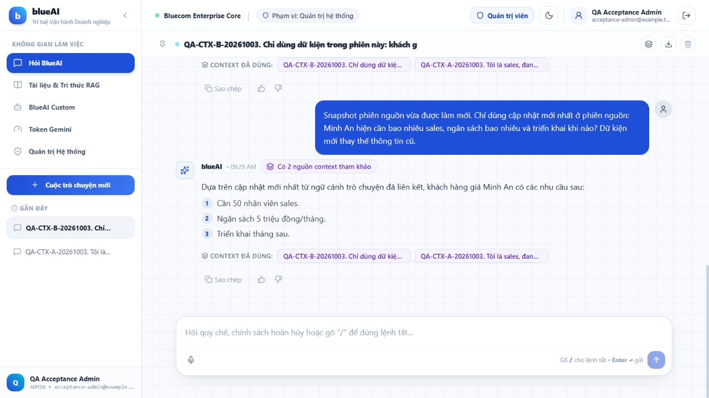
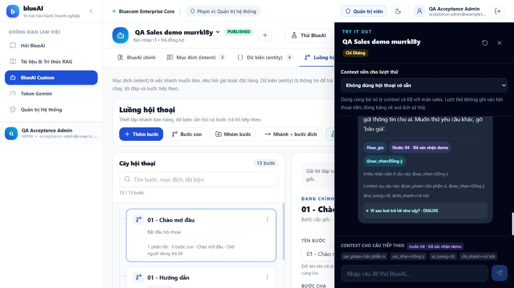
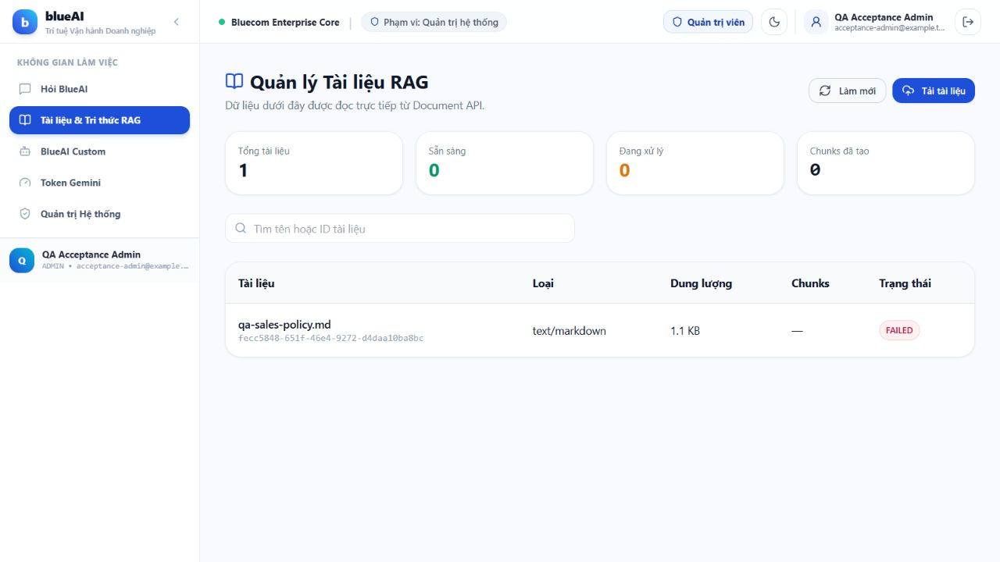

# Báo cáo kiểm thử BlueAI trước production — 03/10/2026

## 1. Kết luận cho người quyết định deploy

**NO-GO production ở phiên bản đang kiểm tra.** Context liên phiên đã hoạt động trong thử nghiệm UI với AI thật, các kịch bản Dialog và nhiều kiểm tra phân quyền/concurrency đạt. Tuy nhiên upload tài liệu mới không tạo được index, frontend thiếu security headers, JDBC chưa ép session UTC và audit image còn finding chưa xử lý/triage. Không được dùng kết quả test xanh để tuyên bố hệ thống không có rủi ro.

Đây là đợt **tạo manual test, chạy kiểm thử và báo cáo**. Không sửa code ứng dụng, không commit/push, không deploy; các đề xuất sửa bên dưới **chưa được triển khai**. Không reset/migrate/restore database local chính của người dùng.

## 2. Phiên bản và phạm vi đã chạy

- Commit: `fbc8179f4aefec489f971fe304d01e97077b7bb8`, branch `feature/conversation-context`.
- Thời gian: ngày 03/10/2026, lượt sáng và lượt tiếp tục chiều, múi giờ Asia/Saigon. Thời điểm trong JSON là UTC.
- Môi trường riêng: Docker project `blueai-preprod-20261003`, MySQL 8.4, Redis 7.4, database/volume riêng; profile backend **qa**, không phải prod. Chỉ bind loopback: web 23000, API 23081, RAG 23800.
- Build lại cả 3 image từ đúng HEAD. Label commit khớp; local manifest digest của API `sha256:abe336fc6eaed2b3e1cf2a608d085c93eb7b67f35fd47d6937ba9fa47359051f`, FE `sha256:27283bcc84e96af6a87d3a90916bff0724f8ccd23fd55360d221b6e82f45e570`, RAG `sha256:ecc1d4227e12013412f4da7b18f1da365753c1acdceffe79e5f903a4a2962122`. Đây không phải bundle release đã publish/duyệt trên registry.
- Dữ liệu là tài khoản, khách hàng, chính sách và bot **giả lập QA**. Không dùng hồ sơ khách hàng thật. Chỉ 8 lượt chat context/thiếu nguồn gọi provider thật; spam/load/recovery dùng Dialog hoặc provider giả.
- Provider key/JWT secret của QA chỉ xử lý trong bộ nhớ tiến trình và cấu hình container, không ghi vào tài liệu, ảnh, kết quả JSON hoặc Git. Tuy nhiên Docker quản trị viên vẫn có thể đọc environment container: đây **không phải** bằng chứng đã triển khai secret manager production.
- Stack chính `blueai-auth` không bị rebuild/restore/xóa. Kiểm tra hash thấy một số file RAG trong container chính khác HEAD; không lấy runtime cũ đó làm bằng chứng cho bản mới.
- CI cùng commit đã có 6/6 job xanh: [Verify](https://github.com/Ductri2006/BlueAI_Platform/actions/runs/37109923186). Đây là bằng chứng CI trước đó, tách riêng với kiểm thử local trong báo cáo.

## 3. Kết quả thực thi, không cộng nhầm skip thành pass

| Nhóm | Kết quả thực tế | Giới hạn / bằng chứng |
| --- | --- | --- |
| Backend Maven verify | BUILD SUCCESS; 355 test entries, **326 thực thi đạt**, 29 skipped, 0 fail/error, 52 suites | Baseline được lưu trước khi các suite có điều kiện ghi đè XML: `qa-mysql-recovery-results.json` |
| MySQL 8.4 / concurrency | 1 migration + 45 auth/task concurrency + 1 old-Flyway seed + 1 new-Flyway upgrade = **48 lượt thực thi đạt**, không skip | Không phải 48 test độc lập cộng thêm vào baseline; một số cùng test chạy lại với điều kiện/engine khác |
| Flyway upgrade | 11.7.2 seed tới V6, 11.20.3 migrate tới **V9**, giữ dữ liệu và checksum; fresh/V5 migration đạt | Disposable DB dùng global timezone +07; test URL có force-session UTC, khác Compose hiện tại |
| Crash recovery thật | Kill/restart backend: 4 PROCESSING tasks được expire, replay không gọi provider thêm; task mới hoàn tất | Provider giả; script fixture riêng, không kill backend chính |
| Frontend | **101/101** Vitest tests đạt, 10 files; TypeScript và Vite build đạt | Không thay cho UI/browser và audit OS image |
| RAG | **60/60** unittest đạt; pip check và pip-audit đạt | Container ingestion UI vẫn lỗi; unit tests chưa bắt được quyền parent directory |
| API acceptance QA | **39 PASS / 0 FAIL** | `qa-api-results.json`; có owner boundary, auth, 6 kịch bản Dialog, release, idempotency và spam |
| Negative/boundary QA | **7 PASS / 1 FAIL** | `qa-negative-results.json`; FAIL security headers. Fake XFF không vượt quota IP; request thứ 31 bị 429 |
| Ingress và Compose | Production config validation, Nginx limits/private routes/XFF/DNS recovery đạt | Backend fixture cho upload-limit test; không phải ingest file 20 MB qua full Java/RAG |
| Backup/restore fixture | SQL row 42, documents và bytes index fixture restore đúng; checksum/gzip/fail-closed tests đạt | Index fixture không phải FAISS index thật; chưa có backup khách hàng mã hóa off-host/RPO/RTO |
| Rollback validator | 18 offline cases đạt | Chưa deploy/rollback production thật |
| Monitoring | Real Alertmanager gửi alert tới receiver stub; Prometheus rules được validate; private routes bị chặn | Chưa xác minh production scrape/end-to-end log và webhook team; `qa-alert-delivery-results.json` |
| Secret scans | Gitleaks v8.30.1: HEAD 7, all-history 9 findings, đều `generic-api-key` ở test/workflow paths | Exit 1, **không gọi là clean scan**. Fixture candidates cần owner review; không chứng minh key cũ đã revoke |
| Dependency/image audits | Xem mục 5 | Scan hoàn tất không đồng nghĩa security gate PASS |

Các expectation của harness đã được chỉnh theo contract: title trống tạo tên mặc định an toàn (201); disabled login trả 403. Đây là sửa **test harness**, không phải sửa ứng dụng để che lỗi.

## 4. Chat sales và Dialog trên giao diện

Đã đăng nhập ADMIN/USER QA, kiểm tra logout/reload, workspace theo role, upload tài liệu mẫu và thao tác context/ghi nhớ. Nhật ký quan sát: `qa-ui-results.json`; ảnh nằm trong `evidence/`.

Chuỗi context với AI thật:

1. Phiên A ghi khách giả Minh An: **40 sales, ngân sách 3 triệu/tháng, triển khai tháng này**. Hỏi tiếp trong A: bot nhớ đúng.
2. Phiên B ở chế độ chỉ phiên hiện tại: bot nói chưa có dữ kiện, không tự lấy A.
3. Liên kết A vào B: bot trả đúng 40 / 3 triệu / tháng này, có trace nguồn context.
4. A cập nhật **50 sales, 5 triệu/tháng, tháng sau**. B chưa refresh vẫn dùng 40 / 3 triệu / tháng này.
5. B refresh snapshot: bot dùng đúng 50 / 5 triệu / tháng sau. Refresh trang vẫn còn lịch sử/configuration. Đây là bằng chứng snapshot liên phiên hoạt động, **không phải** bằng chứng citation knowledge base.



Dialog API đã thử đủ 6 nhóm nghiệp vụ: chào/hướng dẫn; giờ chi nhánh và synonym; thu thập 3 slot; tóm tắt/xác nhận; sửa dữ kiện; fallback. UI bổ sung thử báo giá đủ dữ kiện → đổi 20 thành 30 → xác nhận, giữ sản phẩm A/Hà Nội và trace DIALOG, không tạo CRM/đơn hàng thật. Cancel khi rời màn hình giữ nháp. Nội dung thử đã hoàn nguyên về welcome gốc trước khi rời qua Discard; cấu hình đã lưu vẫn revision 3, nên không xem đó là bao phủ mọi tình huống bỏ draft.



USER chỉ thấy chat, không thấy quản trị/Custom/tài liệu. API kiểm tra riêng vẫn trả 403, không dựa chỉ vào việc ẩn menu. Tiêu đề XSS giả hiển thị nguyên văn; DOM không tạo image có handler tương ứng và không mở alert. Chưa thử mọi payload XSS trong message/node.

## 5. Các finding cần xử lý trước production

### F-01 — P1: Ingestion tài liệu mới thất bại trong container non-root

**Actual:** UI upload `qa-sales-policy.md`, document `fecc5848-651f-46e4-9272-d4daa10ba8bc`; cuối cùng FAILED, 0 READY/0 chunks. Log lặp khi xử lý/restart:

```text
Permission denied: '/app/..rag-index-p9osm2nl'
Permission denied: '/app/..rag-index-elff0k51'
Permission denied: '/app/..rag-index-sjfyzlhv'
uid=10001(blueai)
/app             root:root     0755
/app/.rag-index  blueai:blueai 0755
```

**Nguyên nhân xác nhận:** `feature-rag-chatbot/rag-chatbot/api.py:398` tạo staging bằng `tempfile.mkdtemp(..., dir=index_dir.parent)`. `RAG_INDEX_DIR=/app/.rag-index` trong `BE/compose.yaml:14`; parent là `/app`, không writable với user blueai. `Dockerfile:6,13,23` chỉ cấp quyền cho thư mục index, không cho parent.

**Hướng sửa:** tạo staging/backup dưới thư mục con writable thuộc volume index; giữ thiết kế thay file/rollback atomic và cleanup của đúng attempt. Không sửa bằng chạy root/chown toàn bộ app. Thêm integration test non-root với volume/path giống Compose, ghi **FAISS index thật**, restart và query lại. Sau đó retry fixture QA, phải READY rồi mới chạy KB-03/04/12.

`/health`, `/ready`, `/readiness` vẫn 200 và `indexPresent=true` khi document FAILED. Những endpoint này xác nhận startup/worker sống, không chứng minh tài liệu mới đã READY hoặc index durable.



### F-02 — P1: Frontend chưa có browser security headers

HTML trả qua FE QA thiếu cả `Content-Security-Policy`, `X-Content-Type-Options`, `X-Frame-Options`, `Referrer-Policy`. `FE/nginx.conf` chỉ có các `Retry-After` liên quan throttling, chưa áp policy này. Nếu gateway ngoài bổ sung thì vẫn cần chứng minh trên response domain thật; hiện chưa có bằng chứng.

`FE/src/api/blueAiApi.ts:322–340` lưu access và refresh token bằng **localStorage**, không phải HttpOnly session cookie. XSS thành công có thể đọc token; payload title đã escape đúng không chứng minh toàn ứng dụng miễn XSS.

**Hướng sửa:** CSP phù hợp thực tế (không thêm policy quá chặt làm hỏng widget/voice/API), nosniff, frame-ancestors/frame policy và referrer policy; test cả trang HTML, API error và widget theo route. Quyết định kiến trúc token/session cho production: refresh qua HttpOnly+Secure+SameSite phù hợp và CSRF defense nếu chuyển sang cookie; không chỉ đổi nhãn gọi localStorage là secure cookie. HSTS/redirect phải kiểm trên HTTPS staging, không kết luận từ HTTP QA.

### F-03 — P1: URL JDBC Compose không ép session timezone UTC

Probe bằng driver MySQL Connector/J 9.7.0 và MySQL 8.4 global timezone `+07:00` cho kết quả:

```text
serverTimezone=UTC
  session=+07:00 ; global=+07:00
connectionTimeZone=UTC&forceConnectionTimeZoneToSession=true
  session=+00:00 ; global=+07:00
```

`BE/compose.yaml:63` và default `BE/src/main/resources/application.properties:10` vẫn dùng `serverTimezone=UTC`; production override kế thừa URL base nếu không cấp URL khác. Cấu hình này không bảo đảm clock/session UTC cho ledger/expiry khi deploy trên MySQL non-UTC. Probe xác nhận **configuration gap**, chưa đo một incident expiry thực tế trên dữ liệu production.

**Hướng sửa:** đồng bộ URL Compose/default và URL được cấp từ deploy secret/config store với `connectionTimeZone=UTC&forceConnectionTimeZoneToSession=true`; kiểm tra mỗi pool/session sau startup và chạy expiry/concurrency với chính URL deploy. Test concurrency hiện đạt dùng URL đã force UTC nên không được dùng để phủ nhận finding. Bằng chứng/harness: `qa-jdbc-timezone-results.json`, `qa-jdbc-timezone.ps1`, `QaJdbcTimezoneProbe.java`.

### F-04 — Security gate: dependency và base image cần patch/triage

| Audit | Raw findings | Diễn giải |
| --- | --- | --- |
| npm tất cả dependency | 5 HIGH | braces/chokidar/fast-glob/micromatch/tailwindcss ở build/dev chain, không phải 5 exploit độc lập |
| npm runtime `--omit=dev` | 0 | Không bao phủ OS Nginx image hoặc tool build |
| API image | 7 HIGH + 3 CRITICAL | Java Jackson, HttpCore5/H2, Tomcat; OS Alpine scanner không báo HIGH/CRITICAL |
| FE image | 42 HIGH + 2 CRITICAL | Base `nginx:1.27-alpine`, Alpine 3.21.3; 2 critical là cùng advisory OpenSSL áp cho libcrypto/libssl |
| RAG image | 55 HIGH, 0 CRITICAL | 51 OS package/advisory pairs và 4 Python entries cần xử lý metadata discrepancy |

Trivy v0.75.0 scan thành công với exit 0 vì chỉ chạy scanner, **không đặt exit-code-on-findings**; không diễn giải thành zero-CVE. Số trên đếm package/advisory pairs, không phải từng lỗ hổng có khả năng khai thác đã xác nhận.

Tomcat 10.1.55 có scanner CRITICAL label, nhưng primary advisory Apache đánh giá khác: CVE-2026-65182 Important, CVE-2026-65905 và CVE-2026-68525 Low. Ứng dụng dùng Spring Security JWT; chưa chứng minh các DIGEST/FORM Realm path đó reachable. Không được tuyên bố 3 critical exploit thật, cũng không tự waive. Phiên bản 10.1.58 được scanner gợi ý từng có release vote thất bại; chọn bản **đã publish và còn hỗ trợ**, đối chiếu BOM/tests rồi rescan. [Apache Tomcat security](https://tomcat.apache.org/security-10.html)

RAG metadata đang chạy xác nhận urllib3 **2.8.0**, không có installed distribution msgpack/setuptools; Trivy Python SBOM vẫn nêu urllib3 2.7.0/msgpack 1.1.2/setuptools 70.3.0. Vì vậy 4 entry Python này **chưa được xem là 4 lỗi runtime đang tồn tại**; cần reconcile vị trí SBOM/vendored files. Pip-audit runtime không báo advisory. OS findings vẫn cần triage, có cả entries chưa có fixed version.

**Hướng sửa:** cập nhật base images có hỗ trợ, build với base được pull/pin digest rõ, cập nhật dependency theo BOM/minimal compatible patch, test và rescan. Không tự chạy `npm audit fix --force` nâng Tailwind major chỉ để làm audit xanh. MySQL/Redis/monitoring images chưa được scan trong đợt app-image này; bổ sung trước release.

Reports: `npm-audit-all.json`, `npm-audit-runtime.json`, `trivy-api.json`, `trivy-frontend.json`, `trivy-rag.json`, `qa-audit-summary-results.json`.

### F-05 — Collector logging đã hết vòng đời hỗ trợ

`BE/compose.production.yaml:101` còn `grafana/promtail:3.4.2`. Grafana công bố Promtail EOL từ **02/03/2026**; config validation PASS không giải quyết rủi ro vòng đời. Cần chuyển Alloy/collector được hỗ trợ và test shipping, redaction, retention, restart. [Grafana migration guidance](https://grafana.com/docs/grafana-cloud/send-data/alloy/set-up/migrate/from-promtail/)

### F-06 — Secret review và runtime/release identity còn điều kiện

Gitleaks HEAD 7/all-history 9 finding là generic key trong scripts/test configuration/workflow; `qa-secret-triage-results.json` chỉ xác định **test-path candidates**, chưa chứng nhận mọi giá trị vô hại. History còn path build `target/test-classes`. Cần owner phân loại, allowlist chỉ exact fixture có lý do, không suppress toàn rule/repo. Không đưa Secret/Match nguyên văn vào báo cáo.

Chưa vào provider console xác nhận key từng lộ đã revoked/rotated. Git private không làm key đã lộ trở nên an toàn. Scan không tìm ra key cũng không chứng minh revocation. Scan artifact secrets riêng và xác minh release digest trên registry/máy đích còn chưa chạy.

Runtime main RAG khác source HEAD; khi sửa xong cần promote đúng immutable image đã test, không chỉ pull Git rồi coi container đang chạy đã cập nhật.

## 6. Sổ kết quả toàn bộ 90 manual cases

PASS chỉ áp dụng các bước đã đủ bằng chứng cho case; PARTIAL không cộng là đạt toàn case. Các suite tự động vẫn là bằng chứng riêng, không giả thành thao tác UI. Mã bằng chứng: **U** UI log/ảnh; **A** API acceptance; **N** negative API; **M** MySQL/recovery; **O** ops fixtures; **S** scanner/headers. Expected và bước chi tiết xem `MANUAL_TEST_PRODUCTION_GATE_2026-10-03.md`.

Đối chiếu đủ 90 ID không trùng/không thiếu: **36 PASS, 36 PARTIAL, 5 FAIL, 3 BLOCKED, 10 NOT RUN**. Đây là tổng manual acceptance cases, không cộng chung với số unit/integration tests. Sổ machine-readable: `qa-manual-ledger-results.json`.

| ID | Kết quả | Actual / giới hạn |
| --- | --- | --- |
| REL-01 | PASS | 3 QA images đúng HEAD/commit labels; main cũ không nằm trong kết luận này |
| REL-02 | PARTIAL | 3 Docker builds đạt; secret artifact scan riêng chưa chạy |
| REL-03 | PASS | Fresh QA tới V9, Hibernate validate, 5 services healthy |
| REL-04 | PASS | N: 3 health gates 200; không chứng minh ingestion READY |
| REL-05 | PASS | O: production Compose validation với secret giả |
| REL-06 | PARTIAL | Backend negative configuration tests đạt; chưa startup prod staging thật |
| REL-07 | NOT RUN | Chưa registry release approval/digest/schema fingerprint máy đích |
| REL-08 | NOT RUN | Chưa đo VPS/disk/headroom |
| AUTH-01 | PASS | A: protected 401; U logout về login |
| AUTH-02 | PARTIAL | U trống/sai mật khẩu; email malformed chưa ghi nhận |
| AUTH-03 | PARTIAL | U admin identity/nav/documents/Custom; chưa mọi admin workspace |
| AUTH-04 | PASS | U chỉ chat; A admin/Studio/docs/system 403 |
| AUTH-05 | PARTIAL | A JWT rác/revoked bị chặn; expiry tự nhiên và frontend expired flow chưa chạy |
| AUTH-06 | PASS | A refresh rotation/replay từ chối |
| AUTH-07 | PARTIAL | A revoke refresh; U logout/reload; chưa back variant |
| AUTH-08 | PARTIAL | A tạo user/response trim; toàn paging/filter UI chưa chạy |
| AUTH-09 | PASS | A reset fixture, old login/JWT/refresh vô hiệu, new login đạt |
| AUTH-10 | PARTIAL | A disable/soft-delete và auth bị chặn; includeDeleted/filter variants chưa đủ |
| AUTH-11 | PASS | O real ingress 429 JSON/Retry-After, OPTIONS/no-backend guard |
| AUTH-12 | PASS | A retired public registration/password routes bị chặn |
| CTX-01 | PARTIAL | A persistence/search; U reload/history; paging dài chưa chạy |
| CTX-02 | PASS | A cross-user get/messages/context/delete/memory bị chặn |
| CTX-03 | PASS | U real-provider recall trong A đúng 40 / 3 triệu |
| CTX-04 | PASS | U B CURRENT không tự lấy A |
| CTX-05 | PASS | U link A → B, snapshot/trace/dữ kiện đúng |
| CTX-06 | PASS | U trước/sau refresh: 40/3 → 50/5 đúng, không snapshot drift |
| CTX-07 | PARTIAL | U unlink list; chưa source delete/prompt exclusion; history B không tự bị xóa |
| CTX-08 | NOT RUN | Chưa automatic mode thực tế với positive/negative histories |
| CTX-09 | PARTIAL | A/U memory scope/privacy/save; status variant chưa đủ |
| CTX-10 | PARTIAL | A/U removal/list đạt; chưa hỏi phiên mới để xác minh prompt omission |
| CTX-11 | PARTIAL | A self/cross-user/bad mode; duplicate-link variant chưa đủ |
| CTX-12 | NOT RUN | Chưa actual long-history/budget acceptance |
| KB-01 | FAIL | U FAILED do permission staging parent, không READY |
| KB-02 | PARTIAL | U dashboard/reload ghi đúng FAILED/0; status-search variants chưa đủ |
| KB-03 | BLOCKED | Cần KB-01 READY trước khi hỏi giá có citation |
| KB-04 | BLOCKED | Chưa có READY document/chunk để mở source thật |
| KB-05 | PARTIAL | U empty-KB không bịa holiday policy; populated-KB chưa chạy |
| KB-06 | PASS | A USER docs upload/read bị 403 |
| KB-07 | PARTIAL | N empty/exe/traversal 400; spoofed extension/parser payload chưa đủ |
| KB-08 | PARTIAL | O ingress 2/20/21 MB với fake backend; chưa full Java/RAG |
| KB-09 | PASS | N invalid chunk size/overlap 400 |
| KB-10 | PARTIAL | A wrong/correct key boundaries; O stale-attempt contract; chưa full live stale attempt |
| KB-11 | PARTIAL | U failed state/log sau worker lỗi; transient parser/provider recovery chưa đủ |
| KB-12 | BLOCKED | Không có READY source để thử tombstone/citation removal đầy đủ |
| DLG-01 | PARTIAL | A/U Sales demo 3/4/13/Core off/reload; Starter mới chưa tạo |
| DLG-02 | PASS | A greeting; U welcome nêu demo scope |
| DLG-03 | PASS | A missing slot + 3 branches/Sài Gòn synonym |
| DLG-04 | PASS | A 3-slot multi-turn và interpolated summary |
| DLG-05 | PASS | A/U đủ slot một lượt, không hỏi dư |
| DLG-06 | PASS | A/U 20→30 giữ sản phẩm/chi nhánh, DIALOG |
| DLG-07 | PASS | A confirm/reject khác nhau; U confirm no real transaction |
| DLG-08 | PASS | A early agreement vẫn phải confirm sau summary |
| DLG-09 | PARTIAL | A 35/cancel reset; unknown-product variant chưa đủ |
| DLG-10 | PASS | A configured fallback, không AI/KB |
| DLG-11 | PASS | U changed draft → workspace → Cancel giữ draft |
| DLG-12 | PARTIAL | U hoàn nguyên gốc rồi Discard/reopen; arbitrary changed-draft chưa đủ |
| DLG-13 | PASS | A stale revision 409/không overwrite |
| DLG-14 | PARTIAL | A unknown required entity atomic rejection; toàn cycle/parent variants chưa đủ |
| DLG-15 | PASS | A other admin read/save/publish 404 |
| DLG-16 | PASS | A old widget session vẫn release cũ sau republish |
| API-01 | PARTIAL | A published session/welcome/release; unpublished/bad publicKey chưa đủ |
| API-02 | PARTIAL | A missing/invalid/cross-session token; expired variant chưa chạy |
| API-03 | PASS | A replay exact response với cùng requestId/body |
| API-04 | PASS | A đổi body cùng key conflict |
| API-05 | PASS | A repeated content/new key 429/Retry-After |
| API-06 | PARTIAL | N shared-IP across 3 sessions/XFF spoof chặn request 31; session/quota multi-IP chưa đủ |
| API-07 | PASS | A allowlist/preflight unknown origin 403/no credential wildcard |
| API-08 | PASS | A public response không lộ internal context/trace/intent |
| API-09 | PARTIAL | N restricted capability/unknown fields/revocation; documentIds cross-scope chưa đủ |
| API-10 | PASS | M task auth/concurrency/recovery; provider giả không bị duplicate replay |
| SEC-01 | PARTIAL | U escaped title/no handler/no alert; message/node variants chưa chạy |
| SEC-02 | PARTIAL | A malformed/oversized title; N owner/role/status không thay quyền; chưa mọi input schema |
| SEC-03 | PARTIAL | A SQL-shaped search không owner bypass; chưa toàn endpoint/title variants |
| SEC-04 | PARTIAL | S HEAD/history redacted scan; fixture/real review và revocation/artifact scan chưa đủ |
| SEC-05 | FAIL | S image/advisories còn chưa triage/patch; runtime npm/pip đạt không đủ |
| SEC-06 | FAIL | N thiếu 4 headers; source token localStorage |
| OPS-01 | PARTIAL | M fresh/V5→V9, old V6→V9 đạt; V1/V3 cụ thể chưa chạy |
| OPS-02 | FAIL | Probe Compose URL giữ session +07 khi global +07 |
| OPS-03 | PARTIAL | U restart giữ history/config/FAILED doc; READY FAISS persistence bị chặn |
| OPS-04 | PASS | M real process kill/expire/replay/fresh task đạt |
| OPS-05 | PARTIAL | O real SQL/documents + dummy index bytes; chưa FAISS thật/off-host |
| OPS-06 | PARTIAL | O 18 offline deploy/rollback cases; chưa actual production promotion |
| OPS-07 | PARTIAL | O real alert tới stub/private block/rules; chưa production scrape/webhook team |
| OPS-08 | FAIL | Promtail EOL; log redaction/retention live chưa đủ |
| OPS-09 | NOT RUN | Chưa domain/TLS/firewall/HTTPS staging |
| OPS-10 | NOT RUN | Chưa 2 IP thật sau trusted proxy/CDN |
| OPS-11 | NOT RUN | Chưa load/soak/capacity VPS |
| OPS-12 | NOT RUN | Chưa encrypted off-host backup/RPO/RTO/on-call drill |
| OPS-13 | NOT RUN | Chưa billing cap/provider prod 429/timeout/5xx acceptance |
| OPS-14 | NOT RUN | Chưa team approval/promotion/writer drain/rollback V9 compatibility |

## 7. Thứ tự xử lý và điều kiện được deploy

1. Sửa F-01 với non-root integration test, ingest tài liệu READY và kiểm chứng câu trả lời/source thật, retry/delete/restart index. Đây là điều kiện chức năng quan trọng nhất còn chặn.
2. Sửa F-03 và chạy lại migration/concurrency/expiry bằng **URL đúng của deploy**, không chỉ URL test có force UTC.
3. Hoàn thiện F-02 theo route/browser/session architecture; test trên HTTPS staging, XSS/message render, preflight widget và auth revoke/expiry/back navigation.
4. Patch/triage F-04, chuyển collector F-05; scan app và hạ tầng images, mỗi finding còn lại có owner/rationale/expiry cho risk acceptance. Team security xác nhận secret candidates và provider revocation F-06.
5. Hoàn thành các case PARTIAL/BLOCKED/NOT RUN, đặc biệt automatic/long context, citation/delete, real FAISS restore. Bổ sung prompt injection/document poisoning, bot protection/WAF, encryption at rest và upload parser payloads theo threat model; đợt này chưa chứng nhận các nhóm đó.
6. Dùng staging có domain/TLS, private services, tài nguyên gần VPS dự kiến; test 2 IP thật, load/soak bằng provider giả trước, rồi provider quota/billing/error budget có hạn.
7. Restore **backup thật đã mã hóa off-host**, đo RPO/RTO và rehearse rollback với schema V9/writer tương thích. Xác minh webhook/on-call/retention và ngân sách storage.
8. Team review + CI + staging sign-off, release digest bất biến, kế hoạch migration/maintenance/rollback. Chỉ GO khi gate quan trọng đạt hoặc có người chịu trách nhiệm chấp nhận rủi ro bằng văn bản.

Các rule dạng public DB key/RLS không nên áp máy móc: ứng dụng này dùng MySQL phía server, không phải client-accessible Supabase. Owner checks API đã được thử; encryption ở DB/storage, quyền DB production, backup và các ràng buộc record/field còn phải review đúng kiến trúc thực tế.

## 8. File đã tạo/chỉnh và cách chạy lại an toàn

Tất cả thay đổi đợt này nằm ở **`docs/manual-tests/`**, đang untracked, chưa commit/push:

- `MANUAL_TEST_PRODUCTION_GATE_2026-10-03.md`: 90 case, steps/expected, policy không coi skip/partial là pass; cập nhật schema V9.
- `RESULTS_PRODUCTION_GATE_2026-10-03.md`: báo cáo này, finding và sổ kết quả.
- `compose.acceptance.yaml`, `fixtures/qa-sales-policy.md`: stack QA riêng và dữ liệu giả; **không dùng Compose QA để deploy production**.
- `qa-api-acceptance.mjs`, `qa-negative-api.mjs`: auth/owner/dialog/widget/input/abuse tests có guard localhost/project/profile; chạy lại sẽ tạo thêm fixture QA.
- `qa-mysql-recovery.ps1`: disposable MySQL migration/concurrency/Flyway upgrade/crash recovery.
- `qa-jdbc-timezone.ps1`, `QaJdbcTimezoneProbe.java`: non-UTC probe, cleanup chỉ fixture có label đúng.
- `qa-alert-delivery.ps1`: chạy fixture alert delivery, cleanup temp path được kiểm phạm vi.
- `qa-audit-summary.mjs`: npm audit và tổng hợp scan reports, không sửa dependencies.
- Các `*-results.json`, JSON audit redacted và `evidence/*.png`: bằng chứng; credentials/token thật không được lưu.

Chạy từ repo root sau khi xác minh chỉ vào QA, Node/npm và Docker có sẵn:

```powershell
node docs/manual-tests/qa-api-acceptance.mjs
node docs/manual-tests/qa-negative-api.mjs
pwsh -File docs/manual-tests/qa-mysql-recovery.ps1
pwsh -File docs/manual-tests/qa-jdbc-timezone.ps1
pwsh -File docs/manual-tests/qa-alert-delivery.ps1
node docs/manual-tests/qa-audit-summary.mjs
```

API/negative harness chỉ chạy khi project QA giữ nguyên tên/profile/loopback. Negative runner dự kiến còn exit nonzero ở security headers cho đến khi F-02 được sửa. JDBC script dùng Maven cache volume/driver của đợt này; QA Compose yêu cầu provider/JWT secret qua environment, không dump config ra log. Không tự tái dùng secret/key/sample password QA cho production.

Sau kiểm thử đã logout trình duyệt QA. Các fixture migration/crash/alert riêng đã cleanup theo label; stack QA được dừng nhưng giữ database/volume và ảnh để đối chiếu, không dùng `down -v`. Stack local chính giữ nguyên. Để xem lại QA cần start đúng 5 container project QA, chờ dependencies healthy trước API/FE, rồi mở web 23000; credentials trong harness là **dummy chỉ dành QA**.

**Bản này chưa an toàn để tự deploy production ngay.** Báo cáo cung cấp bằng chứng đạt, lỗi đã tái hiện và danh sách điều kiện còn thiếu, không phải chứng nhận zero-risk.
