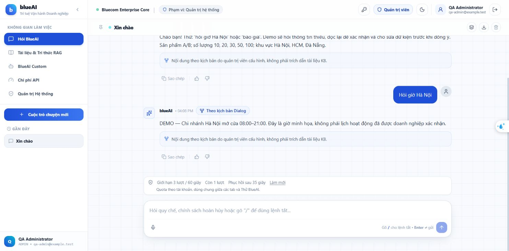
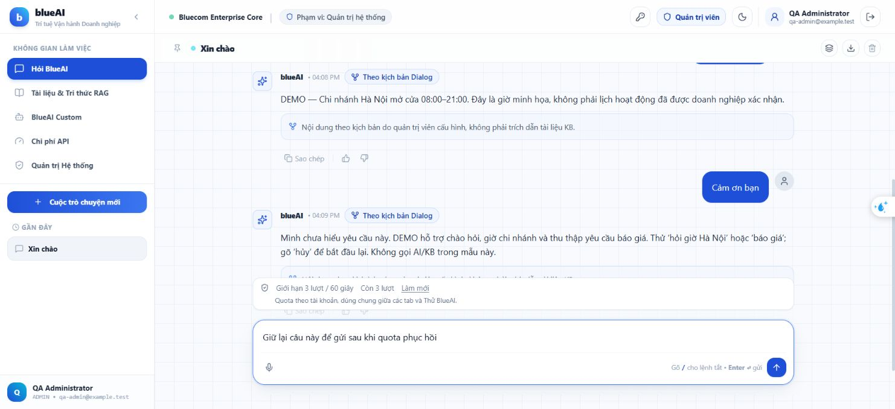
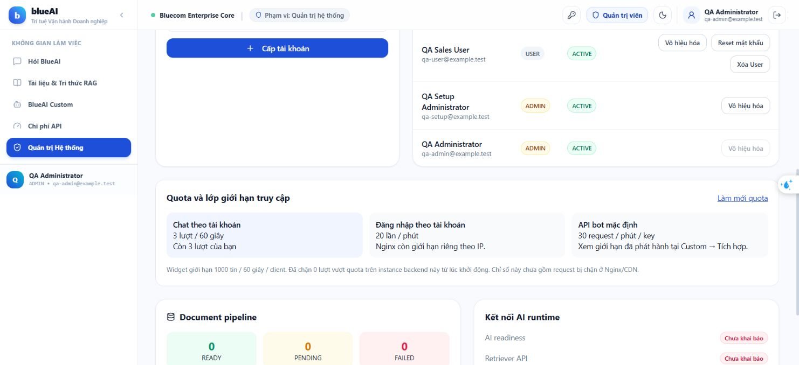
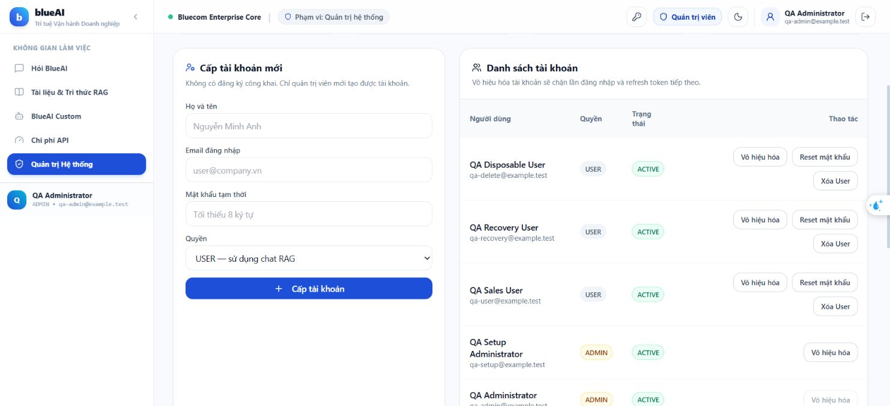
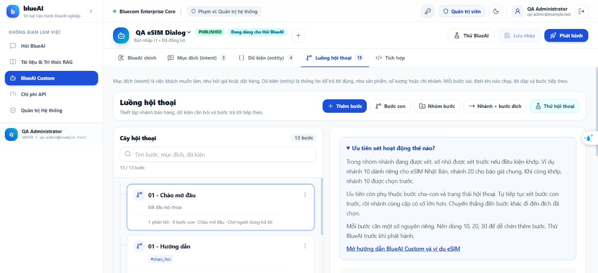
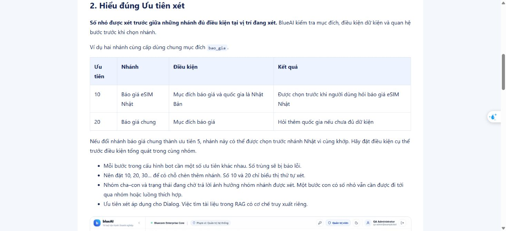
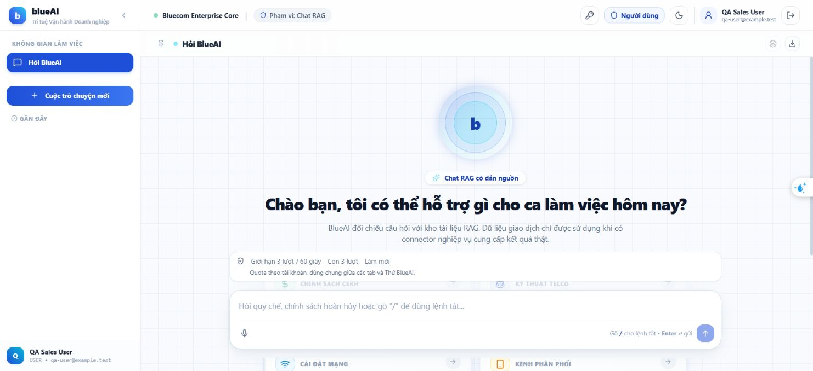
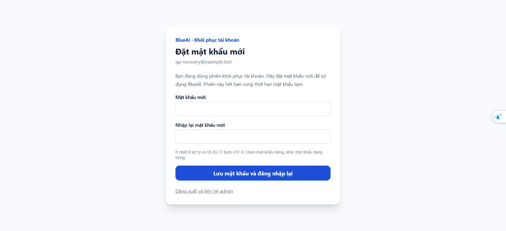

# Quota, quản lý tài khoản và hướng dẫn BlueAI Custom

Ngày kiểm tra 10/11/2026. Nhánh làm việc `feature/quota-account-management`, bắt đầu từ `0656b73` của `codex/blueai-phase1-security`.

## 1. Phạm vi đã triển khai

| Nhóm việc | Kết quả |
| --- | --- |
| Hiển thị quota | Admin và User thấy giới hạn chat theo tài khoản, lượt còn lại và thời gian phục hồi. Admin có bảng chính sách giới hạn và số lượt bị chặn trên instance backend đang phục vụ. |
| Khôi phục tài khoản | Admin xác nhận mật khẩu hiện tại để cấp mật khẩu tạm ngẫu nhiên riêng cho User. Mặc định hết hạn sau 15 phút, chỉ đăng nhập một lần và bắt buộc đặt mật khẩu mới. |
| Tự đổi mật khẩu | Admin/User có nút Đổi mật khẩu trên thanh trên cùng. Đổi thành công thu hồi các phiên hiện tại và yêu cầu đăng nhập lại. |
| Xóa tài khoản | Admin xóa mềm tài khoản USER, thu hồi phiên đăng nhập và giữ lịch sử phục vụ kiểm tra. Backend từ chối xóa ADMIN và xóa chính mình. |
| Hướng dẫn Dialog | Giải thích ngay cạnh phần cấu hình Ưu tiên xét, kèm tài liệu có ví dụ eSIM, ảnh giao diện và hướng dẫn thử/phát hành. |

Phần DDoS thuộc đầu việc do thành viên khác phụ trách theo phân công của team.

## 2. Cách hoạt động

### Quota

- Hỏi BlueAI và Thử BlueAI dùng chung bộ đếm của tài khoản. Mỗi lượt preview tính một lần, kể cả cấu hình chỉ Dialog.
- Backend là nơi quyết định giới hạn. API đọc quota dùng cùng bộ đếm với API gửi câu hỏi và không tiêu lượt hoặc kéo dài cửa sổ đếm.
- Mặc định chat 30 lượt/phút. Môi trường QA dùng 3 lượt/phút để dễ kiểm tra chặn và phục hồi. Giá trị hiển thị được đọc từ backend.
- Bộ đếm Redis được cập nhật nguyên tử. Kiểm tra thực tế với hai instance limiter và các yêu cầu đồng thời đã đạt.
- Khi hết lượt, giao diện khóa gửi và giữ nội dung đang soạn. Khi hết cửa sổ, giao diện đọc lại quota và cho gửi tiếp.
- Nếu không đọc được bộ đếm, giao diện thông báo chưa tải được quota. Request gửi vẫn chịu kiểm tra ở backend.
- Số lượt bị chặn trong trang Admin là tổng từ lúc instance backend khởi động. Quota chat là hạn mức riêng của tài khoản đang đăng nhập. Hai chỉ số có phạm vi khác nhau.

### Mật khẩu tạm riêng

1. User liên hệ admin và được xác minh đúng chủ tài khoản.
2. Admin mở Quản trị Hệ thống, chọn Reset mật khẩu tại đúng dòng User.
3. Admin nhập mật khẩu hiện tại để xác nhận.
4. Server sinh 18 byte ngẫu nhiên, mã hóa thành mật khẩu tạm 24 ký tự. Mật khẩu chỉ được trả trong response cấp mới với `Cache-Control: no-store`. Database lưu bản băm.
5. Admin gửi riêng mật khẩu tạm cho đúng User, kèm thời điểm hết hạn hiển thị trên giao diện.
6. User dùng mật khẩu tạm một lần để mở màn Đặt mật khẩu mới. Phiên khôi phục bị giới hạn quyền, API nghiệp vụ trả 403.
7. User đặt mật khẩu riêng, nhập lại để xác nhận và đăng nhập lại sau khi lưu thành công.
8. Nếu hết hạn, đóng mất phiên hoặc mất mật khẩu tạm, admin cấp lại. Lần cấp mới thu hồi thông tin đăng nhập và phiên của lần cấp trước.

Admin chỉ cấp mật khẩu tạm cho USER. Các endpoint đổi mật khẩu giới hạn 5 lần/phút theo tài khoản, endpoint cấp lại giới hạn 5 lần/phút theo admin. Mật khẩu mới tối thiểu 8 ký tự, tối đa 72 byte UTF-8 và phải khác mật khẩu hiện tại.

### Ưu tiên Dialog

Số nhỏ được xét trước trong nhóm nhánh đủ điều kiện tại vị trí hiện tại. Cần xét cả mục đích, dữ kiện, bước cha–con và trạng thái hội thoại. Mỗi bước có số nguyên riêng. Tài liệu trình bày ví dụ nhánh eSIM Nhật ưu tiên 10 và báo giá chung ưu tiên 20, cùng các hành động chờ, tự tiếp tục và chuyển thẳng đến bước đích.

[Mở hướng dẫn BlueAI Custom](../../FE/public/guides/blueai-custom.html)

## 3. Môi trường và kết quả kiểm tra

| Hạng mục | Kết quả |
| --- | --- |
| Backend toàn bộ suite trước khi push | 556 bài đạt, 0 thất bại, 0 lỗi, 0 bỏ qua |
| Frontend trước khi push | 149 bài đạt, 19 file test |
| Bản dựng frontend | TypeScript và Vite build thành công |
| HTTP thực tế | 40 kiểm tra đạt trên server QA đang chạy |
| Nhiều tab | 13 lần refresh thành công, 0 sự kiện dùng lại refresh token trong lượt kiểm tra |
| MySQL | MySQL 8.4, gồm migration mới, dữ liệu cũ, khôi phục mật khẩu, phiên đồng thời và chia sẻ workspace Admin |
| Nâng Flyway | Seed V6 bằng 11.7.2, nâng bằng 11.20.3 đến V14, giữ dữ liệu và lịch sử migration |
| Redis | Redis 7.4 thực tế, kiểm tra tính nguyên tử, chia sẻ counter và TTL không bị kéo dài khi đọc |
| Cấu hình triển khai | Kiểm tra Production Compose đạt |
| Quét secret trên thay đổi | Không có kết quả khớp mẫu private key, Google API key, GitHub token, AWS access key và OpenAI key trong các file kiểm tra |

Backend HTTP chạy tại `127.0.0.1:19305`, frontend QA tại `localhost:19304`. Database và Redis kiểm thử riêng, dùng dữ liệu giả lập. Provider AI được tắt trong lượt kiểm tra giao diện Dialog này.

Các bài backend dùng cả H2 và MySQL. Kết quả HTTP chi tiết nằm trong file JSON cùng thư mục ảnh. Đây là kiểm tra local cho bản thay đổi này. GitHub Actions và staging cần chạy trên commit được phát hành để nghiệm thu môi trường triển khai.

Trong lượt kiểm tra nhiều tab, đã sửa lỗi hai tab cùng dùng một refresh token bằng cách phối hợp các request cookie auth. Một lượt chạy lại backend cũng phát hiện bài kiểm thử dọn tombstone phụ thuộc độ phân giải đồng hồ. Fixture của bài này đã chuyển sang thời điểm xóa nằm rõ ràng trong quá khứ, vẫn giữ kiểm tra thứ tự ưu tiên dọn và retry.

## 4. Các tình huống đã kiểm tra

| Mã | Thao tác / điều kiện | Kết quả quan sát |
| --- | --- | --- |
| Q01 | Admin mở Hỏi BlueAI | Hiển thị giới hạn, số lượt còn lại, nút tải lại quota. |
| Q02 | User mở Hỏi BlueAI | Hiển thị quota tài khoản User, ẩn khu quản trị. |
| Q03 | Gửi đến hết 3 lượt trong QA | Bộ đếm về 0, nút gửi bị khóa, có đếm ngược. |
| Q04 | Soạn câu tiếp theo khi hết lượt | Nội dung vẫn được giữ trong ô nhập. |
| Q05 | Chờ hết cửa sổ | Bộ đếm phục hồi, nút gửi hoạt động, câu đang soạn được giữ. |
| Q06 | Đọc quota nhiều lần | Không giảm lượt và không kéo dài TTL. |
| Q07 | Dùng preview Dialog rồi Hỏi BlueAI | Cùng tiêu quota tài khoản, mỗi preview tính một lượt. |
| Q08 | Hai instance Redis limiter nhận yêu cầu đồng thời | Số yêu cầu được nhận đúng giới hạn, account khác có bộ đếm riêng. |
| Q09 | User truy cập tổng quan Admin / người chưa đăng nhập đọc quota | Trả 403 / 401 tương ứng. |
| A01 | Admin mở bảng reset User | Hiển thị đúng tài khoản và yêu cầu mật khẩu admin. |
| A02 | Reset với mật khẩu admin sai / target ADMIN | Backend từ chối 400 / 403. |
| A03 | Reset User hợp lệ | Sinh mật khẩu riêng, thời hạn 15 phút, response no-store, phiên cũ bị thu hồi. |
| A04 | Đăng nhập bằng mật khẩu tạm | Chuyển đúng màn bắt buộc đặt mật khẩu mới, API nghiệp vụ trả 403. |
| A05 | Đăng nhập lần hai bằng cùng mật khẩu tạm | Bị từ chối 401. |
| A06 | Đổi mật khẩu qua HTTP rồi đăng nhập lại | Trả 204, thu hồi token cũ, mật khẩu riêng đăng nhập được và có quyền bình thường. |
| A07 | Cấp mật khẩu tạm lần tiếp theo | Giá trị khác lần trước, mật khẩu và phiên khôi phục cũ bị vô hiệu hóa. |
| A08 | Mật khẩu / phiên khôi phục hết hạn | Không đăng nhập, refresh hoặc đổi mật khẩu được. Được kiểm tra tự động. |
| A09 | Hai lần đăng nhập tạm đồng thời | Chỉ một lần thành công, chạy cả trên MySQL. |
| A10 | Request dùng JWT cũ đã qua xác thực trước khi admin reset | Kiểm tra phiên và authVersion bên trong transaction ngăn đổi mật khẩu trái phép. |
| A11 | Đổi mật khẩu bình thường | Phải cung cấp mật khẩu hiện tại. Phiên cũ bị thu hồi, phải đăng nhập lại. |
| A12 | User xóa tài khoản / Admin xóa ADMIN / tự xóa | Backend từ chối. Dòng ADMIN không có nút xóa User. |
| A13 | Admin xóa mềm User | Tài khoản bị ẩn khỏi danh sách thông thường, token cũ và đăng nhập bị chặn. |
| A14 | Hai tab cùng cần refresh | Các request cookie auth được phối hợp bằng Web Locks, nhật ký QA không có refresh-token reuse. |
| D01 | Mở Luồng hội thoại và phần Ưu tiên xét | Giải thích hiển thị ngay trong inspector, có liên kết hướng dẫn. |
| D02 | Mở tài liệu và mục ưu tiên | Ví dụ, ảnh, mục lục và phần hướng dẫn hoạt động. |

Luồng đổi và reset mật khẩu được kiểm tra thực thi bằng API/MockMvc, HTTP thực tế và các bài frontend API. Trên trình duyệt, đã kiểm tra các form, quyền hiển thị và màn bắt buộc đổi mật khẩu. Việc nhập và bấm lưu mật khẩu mới trực tiếp trên giao diện cần người kiểm thử thực hiện theo quy tắc thao tác thông tin đăng nhập của công cụ điều khiển trình duyệt.

Script `BE/ops/security-e2e.mjs` đã được cập nhật theo contract mới. Script này chỉ chấp nhận ingress staging HTTPS. Kết quả HTTP local nêu trên được thực hiện bằng bộ kiểm tra riêng, cần chạy lại script staging khi có bản phát hành phù hợp.

## 5. Ảnh minh chứng

### Hết quota và giữ bản nháp

### Quota phục hồi

### Quản trị quota và tài khoản

### Xác nhận reset đúng User

### Giải thích ưu tiên Dialog

### Tự đổi mật khẩu

### Hướng dẫn sử dụng

### Quota của User

### Bắt buộc đổi mật khẩu

[Kết quả 40 kiểm tra HTTP](evidence/quota-account-20261110/http-results.json)

[Tổng hợp xác nhận kiểm thử](evidence/quota-account-20261110/verification-summary.json)

[Kết quả quét mẫu secret](evidence/quota-account-20261110/security-scan.json)

## 6. Các file chính

| Phần | File |
| --- | --- |
| Migration | `BE/src/main/resources/db/migration/V14__temporary_password_recovery.sql` |
| Mật khẩu và phiên | `BE/src/main/java/com/blueai/auth/service/AuthService.java`, `AdminUserService.java`, model `User.java` |
| Phân quyền / API | `SecurityConfig.java`, `AdminUserController.java`, `AuthController.java`, `BrowserAuthController.java`, `QuotaController.java` trong module auth |
| Bộ đếm | `BE/src/main/java/com/blueai/studio/service/WidgetRateLimiter.java`, `WidgetProtectionMetrics.java`, `RagChatService.java`, `BotStudioService.java` |
| API frontend | `FE/src/api/blueAiApi.ts` |
| Quota chat | `FE/src/components/chat/useChatQuota.ts`, `QuotaIndicator.tsx`, `Composer.tsx`, `FE/src/store/useAppStore.ts` |
| Tài khoản | `FE/src/components/auth/PasswordChangeForm.tsx`, `FE/src/components/dashboards/AccountActionDialog.tsx`, `AdminDashboard.tsx`, `QuotaOverviewPanel.tsx`, `FE/src/components/layout/TopHeader.tsx`, `FE/src/App.tsx` |
| Hướng dẫn | `FE/src/components/studio/DialogPriorityHelp.tsx`, `ChatbotStudio.tsx`, `FE/public/guides/blueai-custom.html` |
| Test / CI | Các test password recovery, quota, Redis, migration và frontend mới, `.github/workflows/verify.yml`, `BE/ops/security-e2e.mjs` |
| Ổn định test thời gian | `BE/src/test/java/com/blueai/rag/document/controller/WorkerDocumentIntegrationTest.java` |
| Vận hành | `BE/PRODUCTION_DEPLOYMENT.md` |

## 7. Điểm cần kiểm tra khi phát hành

1. Triển khai backend và frontend cùng phiên bản. Backup database và để Flyway áp dụng V14 theo quy trình deploy hiện hành.
2. Tài khoản đang tồn tại nhận giá trị mặc định `password_change_required=false`. Các lần reset mới dùng luồng mật khẩu tạm.
3. Endpoint `POST /api/v1/admin/users/{id}/password` đổi contract. Request gửi `currentPassword` của admin, response 200 gồm `temporaryPassword` và `expiresAt`. Tích hợp cũ gửi `newPassword` cần cập nhật.
4. Thuộc tính `app.auth.temporary-password-ttl` mặc định `15m`, giá trị dương tối đa một ngày. Production tiếp tục cần Redis dùng chung để giữ quota giữa các backend.
5. QA thực hiện thêm lượt thao tác nhập/xác nhận mật khẩu trên UI bằng tài khoản dùng riêng cho staging, kiểm tra phát hành guide và chạy script HTTPS staging.
6. Phần phối hợp refresh nhiều tab sử dụng Web Locks khi trình duyệt có hỗ trợ. Lượt thực tế đã kiểm tra trên Chrome, các trình duyệt team hỗ trợ cần được đưa vào ma trận QA.
