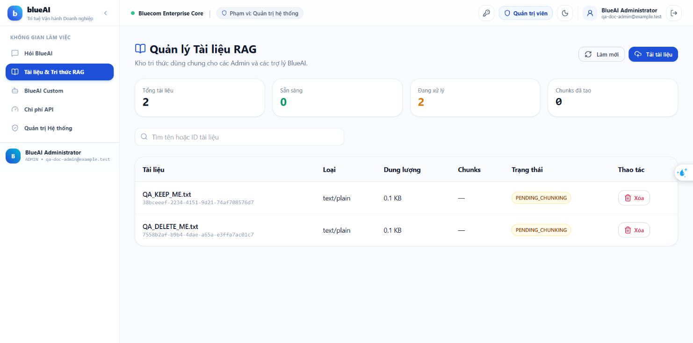
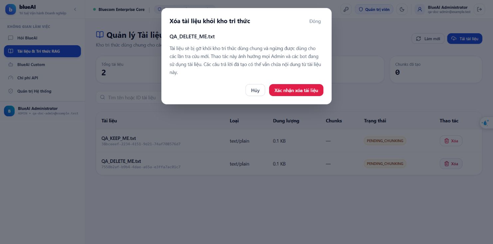
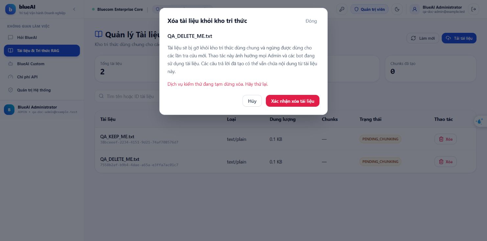
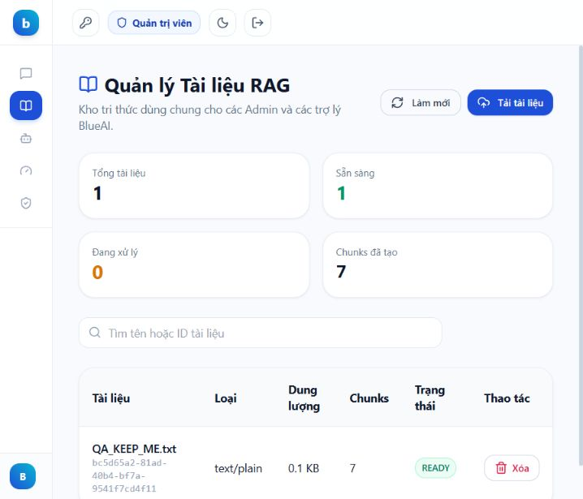
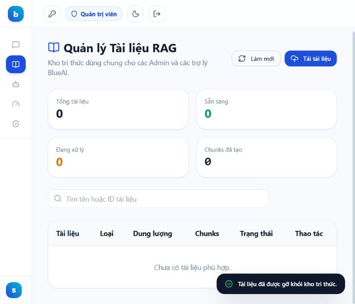

# Xóa tài liệu khỏi kho tri thức RAG

Đã bổ sung và kiểm tra ngày 10/11/2026 trên branch `feature/quota-account-management`.

## Cách triển khai

Backend đã có `DELETE /api/v1/documents/{documentId}` với cơ chế xóa mềm và kiểm tra quyền. Frontend được bổ sung phương thức gọi API, nút Xóa ở từng dòng và bảng xác nhận ghi rõ tên tài liệu cùng phạm vi ảnh hưởng đến kho Admin dùng chung.

Khi xác nhận, giao diện khóa thao tác lặp. Sau response thành công, dòng tài liệu được gỡ và danh sách được tải lại để cập nhật tổng tài liệu, trạng thái và số chunks. Response danh sách cũ được bỏ qua để tránh hiện lại dòng vừa xóa. Khi có lỗi, bảng xác nhận hiển thị thông báo và cho thử lại. Tình huống tài liệu đã được Admin khác hoặc worker dọn trước đó được xử lý đồng bộ lại danh sách.

Server ghi nhận tài liệu đã xóa ngay trong database. Các lần truy xuất mới lọc bỏ tài liệu này trước khi tạo nội dung gửi cho AI. Server đồng thời yêu cầu RAG dọn vector, các lần dọn thất bại được xử lý lại qua cơ chế retention/worker hiện có. File lưu trữ được dọn theo cấu hình retention. Các câu trả lời đã tạo có thể vẫn chứa nội dung từ tài liệu đã xóa trong lịch sử hội thoại.

## Cách sử dụng

1. Đăng nhập Admin, mở Tài liệu & Tri thức RAG.
2. Chọn Xóa tại đúng dòng tài liệu.
3. Kiểm tra tên tài liệu và ảnh hưởng đến kho dùng chung.
4. Chọn Hủy để quay lại hoặc Xác nhận xóa tài liệu để thực hiện.
5. Kiểm tra thông báo thành công, danh sách và số liệu cập nhật. Khi gặp lỗi, đọc thông báo trong bảng rồi thử lại.

## Các file thay đổi

| File | Nội dung |
| --- | --- |
| `FE/src/components/dashboards/KnowledgeDashboard.tsx` | Nút xóa, xác nhận, chống gửi lặp, cập nhật danh sách, xử lý lỗi và response cũ |
| `FE/src/api/blueAiApi.ts` | Phương thức `deleteDocument` gọi API bằng phiên đăng nhập hiện tại |
| `FE/src/api/documentDeletionApi.test.ts` | Kiểm tra ID được encode, DELETE có Bearer, response 204 và các lỗi 403/404/503 |
| `BE/src/test/java/com/blueai/studio/controller/SharedAdminWorkspaceIntegrationTest.java` | Regression cho trường hợp chỉ mục còn trả về tài liệu đã xóa, kiểm tra prompt gửi AI chỉ nhận tài liệu còn hiệu lực |

## Kết quả kiểm thử

| Phần | Kết quả |
| --- | --- |
| Frontend toàn bộ suite | 149/149 đạt, 19 file test |
| Frontend build | TypeScript và Vite đạt |
| Backend liên quan | 66 ca đạt trong 5 lớp kiểm thử, gồm upload/xóa tài liệu, worker, workspace Admin, chat context và Bot Studio |
| Backend toàn bộ suite trước khi push | 556/556 đạt, 0 lỗi và 0 bỏ qua, gồm MySQL 8.4 và Redis thực tế |
| HTTP thực tế | 8 kiểm tra đạt trên server QA riêng |
| Trình duyệt | Hủy, lỗi 503 giả lập rồi thử lại thành công, tải lại sau xóa, xóa tài liệu pending và xử lý Admin khác đã xóa cùng tài liệu |
| Thống kê | Tài liệu READY với 7 chunks được loại khỏi danh sách, tổng tài liệu/READY/chunks cập nhật về 0 |

Các kiểm tra HTTP gồm anonymous bị 401, User bị 403, Admin khác thấy kho dùng chung đã cập nhật, GET tài liệu đã xóa trả 404, tìm kiếm bỏ tài liệu đã xóa, xóa lặp trả 204, worker không claim tài liệu đã xóa và nhận kết quả READY cho fixture còn hiệu lực.

Test trình duyệt dùng tài khoản và hai tài liệu giả lập trên môi trường local riêng. Số chunks READY được thiết lập qua callback worker kiểm thử. Test lọc nội dung RAG dùng retrieval/LLM giả lập để kiểm tra chính xác request gửi AI. Việc dọn vector và file trên hạ tầng production cần được xác nhận trong lượt staging/deploy thực tế.

Trước khi push, đã chạy lại toàn bộ backend và frontend cùng phiên bản có tính năng xóa tài liệu. Kết quả tổng hợp nằm trong báo cáo quota/tài khoản và file verification-summary kèm theo.

## Ảnh minh chứng

[Kết quả HTTP](evidence/document-delete-20261110/http-results.json)
